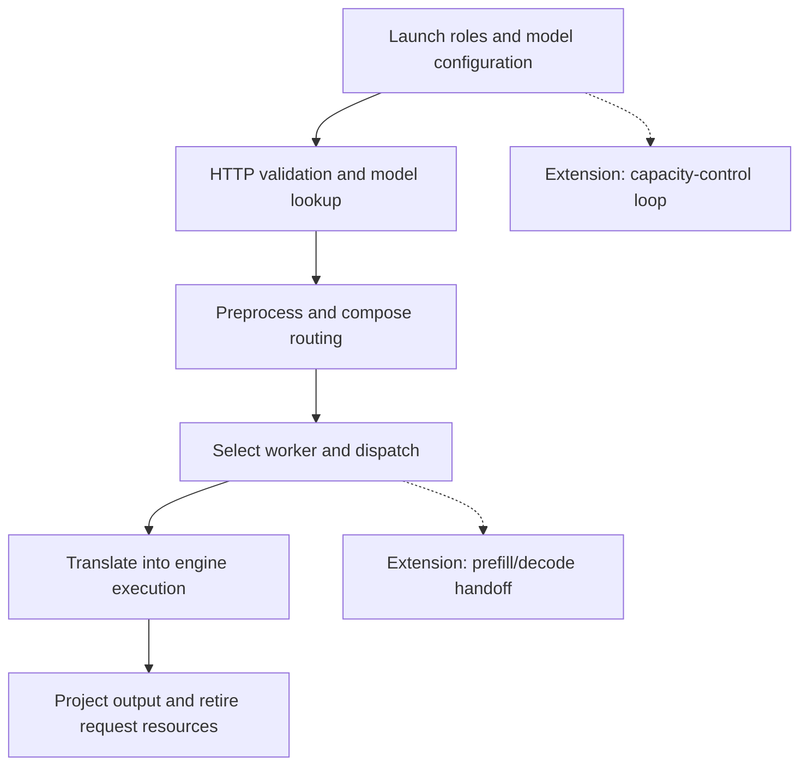

import Source from '../../../../components/Source.astro';

## Trace one ordinary request first

Use this reading route to connect the architecture chapters to source. Begin with aggregated vLLM serving: the frontend routes to one engine worker, which handles prompt processing and generation. That exposes the main control path before adding stage transfer or capacity management.

The goal is a compact trace containing the owners, the values crossing each interface, and the few decisions that change the route. Source reading is enough to build it; running a GPU service is a later way to observe the same boundaries.

<Source project="dynamo" path="examples/backends/vllm/launch/agg.sh" label="Aggregated serving launch example" />

## The code route

The main arrows are one request route. The two extensions add architectural mechanisms without changing which component owns the engine's token scheduler.

## Follow the forward and return paths

1. Read the launch example to identify frontend and worker processes and the selected engine.
2. Open <Source project="dynamo" path="lib/llm/src/http/service/openai.rs" label="Completion handlers" />. Locate request validation, model lookup, and the call to the composed engine.
3. Open <Source project="dynamo" path="lib/llm/src/entrypoint/input/common.rs" label="Pipeline construction" />. Follow forward preprocessing/routing operators and the backward output route.
4. Read <Source project="dynamo" path="lib/kv-router/src/services/selection/core/operation.rs" label="Selection operation" /> and <Source project="dynamo" path="lib/kv-router/src/services/selection/core/run.rs" label="Selection execution" />. Identify eligibility, placement policy, and any booking owner.
5. Enter <Source project="dynamo" path="components/src/dynamo/vllm/handlers.py" label="vLLM handlers" />. Find engine input construction, generation, output projection, and lifecycle cleanup.

At each boundary, record a representative input, output, and retained resource. For example: public text becomes token work; a worker choice becomes endpoint dispatch; an engine result becomes a backend stream item. Carry request identity through the return path as well as the forward call.

## Add the extension you need

For distributed prompt processing, compare the <Source project="dynamo" path="examples/backends/vllm/launch/disagg.sh" label="Disaggregated launch example" /> with the baseline. Then trace <Source project="dynamo" path="lib/llm/src/kv_router/prefill_router/handoff.rs" label="Stage handoff" /> and the adapter's connector strategy. Label continuation metadata and actual KV movement as separate edges. See [prefill/decode](/architecture/dynamo/prefill-decode/).

For capacity changes, begin a separate route at <Source project="dynamo" path="components/src/dynamo/planner/core/base.py" label="Planner tick and effect submission" />. Follow observation, decision, effect admission, and environment application. Compare desired capacity with later ready-worker observations. See [planning](/architecture/dynamo/planning-and-reconfiguration/).

## Keep a small architectural result

The useful outcome is a request-flow sketch and a short source route, not a catalog of every helper. Include the decision owner for placement, engine scheduling, state transfer, and capacity. Add a low-level branch only when it explains the behavior you are investigating.

Existing tests can then answer a focused implementation question. The guide's main path should remain understandable before reading test fixtures, concurrency races, or every supported configuration.
