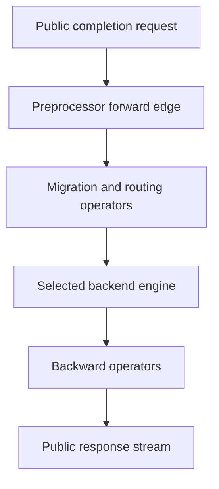

import Source from '../../../../components/Source.astro';

## The frontend turns an API call into model work

Dynamo's frontend validates the public request, resolves a model, preprocesses input, and connects routing to a backend worker. It also translates the returned output into the client's response protocol. Following both directions explains why the frontend contains more than HTTP forwarding code.

Use one streaming text completion with an already discovered model as the baseline. Chat formatting, multimodal input, and separate serving stages extend the same pipeline after this path is clear.

## Follow one request through the pipeline



Forward operators prepare and route work. Backward operators project engine results into the response. In dynamic serving, the selected backend includes the remote worker boundary.

1. **Validate and identify.** The HTTP handler parses the request, checks serving/model availability, applies public policy, and creates request context.
2. **Resolve the model.** The model manager supplies the model-specific completion engine assembled by discovery and configuration.
3. **Prepare and route.** Preprocessing produces tokens and normalized options. Routing and any configured stage operators select where execution should happen.
4. **Invoke the backend.** The pipeline reaches the chosen worker through the runtime and adapter.
5. **Project output.** Returning operators handle token/text semantics and shape the public stream or final response.

<Source project="dynamo" path="lib/llm/src/http/service/openai.rs" label="Completion handlers and model lookup" />
<Source project="dynamo" path="lib/llm/src/entrypoint/input/common.rs" label="PreprocessedRouting.build_pipeline" />

The public call into this composed engine is small:

```rust
let stream = engine.generate(request).await.map_err(|e| {
```

Here `engine` represents the assembled serving pipeline. Its work can include frontend processing and routing before the model engine executes anything.

## Response commitment is a lifecycle boundary

Acquiring an internal stream and committing a successful HTTP response are separate events. The streaming handler checks initial backend output before committing headers so an early backend error can become an appropriate HTTP error. Later failures use the response stream's error behavior.

Nonstreaming requests aggregate the internal stream into one response. They still traverse the same request preparation and can encounter intermediate errors. The distinction changes presentation rather than removing the underlying lifecycle.

Connection guards propagate client disconnection into request cancellation. The response stream retains the lifetime responsibilities that must survive the handler's return. Engine resource retirement continues through the adapter and engine, as described in [cancellation](/architecture/dynamo/cancellation-failure/).

## Where to investigate a slow or incorrect request

| Observation | Follow this boundary |
| --- | --- |
| Rejected before dispatch | Public validation, model readiness, model lookup |
| Long wait before worker work | Preprocessing and routing/admission |
| Correct internal tokens, wrong client output | Backward operators and response aggregation |
| Work continues after a disconnect | Request context and adapter/engine cleanup |

Preprocessing itself can consume substantial CPU work through formatting and tokenization. Inspect where the delay occurs before deciding that more GPU workers are the right response.

## Read the code

Read `handler_completions`, `completions_single`, pipeline assembly, and the selected preprocessor in sequence. Then follow the backend return through backward operators and response construction. The <Source project="dynamo" path="lib/llm/src/preprocessor.rs" label="OpenAIPreprocessor" /> is the next source boundary when the tokenized input differs from what the caller expected; <Source project="dynamo" path="lib/llm/src/http/service/disconnect.rs" label="Connection and stream guards" /> explains connection lifetime.
