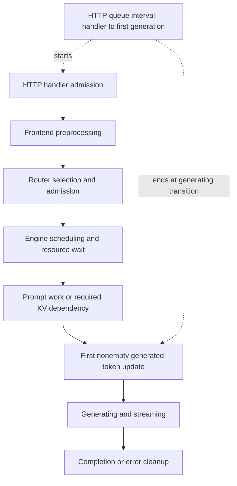

import Source from '../../../../components/Source.astro';

## Match a measurement to its owner

A slow first token can come from frontend processing, placement/admission, engine queues, prompt compute, or KV dependency waiting. Dynamo emits observations at several of those boundaries. Understanding their scope is the first step toward a useful diagnosis.

For each measurement, identify its producer, start/end events, and request or worker identity. Then use tracing to connect the intervals across components. This gives a causal route through the architecture without treating one dashboard number as the whole explanation.

## Place metrics on the request path

The HTTP first-token waiting interval spans several owners. A small router queue can coexist with a long frontend-reported wait because preprocessing, prefill, and transfer dependencies contribute elsewhere in that interval.

## Frontend, worker, and routing observations

Frontend request metrics track admission, known input tokens, first generated output, streaming, and completion. The metrics handle travels with request context so pipeline stages can report progress. A metadata-only stream item does not count as a generated-token transition.

Input-token count can become known after request admission, once preprocessing has tokenized the prompt. This explains why request gauges and token gauges can change at different moments. Output accounting likewise follows the emitted token meaning rather than treating every internal result as one token.

<Source project="dynamo" path="lib/llm/src/http/service/metrics.rs" label="Frontend request metrics and interval definitions" />
<Source project="dynamo" path="lib/llm/src/http/service/openai.rs" label="HTTP metric guard placement" />

Worker scheduling/forward-pass reports describe engine-side execution. In the selected vLLM integration, the timing is derived from scheduler/update boundaries and is an execution observation for the serving system. Client inter-token delay and individual GPU-kernel timing have different scopes.

Frontend load frames publish a snapshot for a particular frontend instance and counter lifetime. Cache events separately inform prefix availability, while router accounting tracks routed work. Their consumers need those scopes and update boundaries to interpret the values together.

<Source project="dynamo" path="components/src/dynamo/vllm/instrumented_scheduler.py" label="Worker scheduling and timing observations" />
<Source project="dynamo" path="lib/llm/src/frontend_load.rs" label="Frontend load snapshots" />

## Trace a useful comparison

Consider two requests with equal first-token delay. For A, preprocessing consumes most of the wait before dispatch. For B, dispatch is fast but decode waits for KV state. A points toward formatting/tokenization and frontend CPU capacity. B points toward handoff, connector progress, and engine readiness.

Correlate request and worker identity, then compare the stage spans and their boundaries. Retain prompt/output lengths and cache warmth when comparing work: the same model can serve very different request costs.

Framework trace links preserve causality across prefill/decode or migration boundaries. They travel separately from engine continuation parameters because tracing and engine handoff have different owners.

<Source project="dynamo" path="lib/llm/src/protocols/common/preprocessor.rs" label="Request trace-link definitions" />

## Decisions and code route

- **Long first-token wait:** locate the responsible stage before changing worker capacity.
- **Unexpected placement:** compare the router's cache/load evidence and booked work at decision time.
- **Unexpected capacity change:** inspect the Planner's selected observation and policy, then the applied deployment state.

Read frontend metric definitions, handler guards, load-frame production, worker publication, and the consuming router/Planner. The [frontend](/architecture/dynamo/frontend-path/) and [planning](/architecture/dynamo/planning-and-reconfiguration/) chapters connect those measurements to the decisions they explain.
