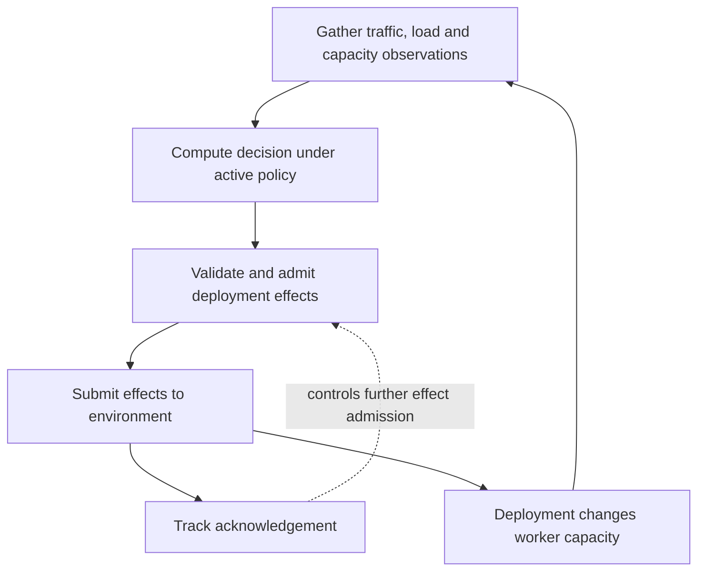

import Source from '../../../../components/Source.astro';

## Control capacity at a different timescale

The router chooses a worker for a request. An engine schedules tokens on that worker. Dynamo's Planner observes demand and execution behavior, then proposes capacity or other configured deployment effects. These are three control loops with different owners and timescales.

A Planner decision is a desired change. The deployment environment applies that change, and later observations reveal the resulting ready capacity. Separating proposal, submission, acknowledgement, and readiness is enough to follow the control architecture.

## Follow one planning tick

Acknowledgement and observed ready capacity answer different questions. The feedback loop checks the deployment rather than treating a submitted target as immediately available workers.

<Source project="dynamo" path="components/src/dynamo/planner/core/base.py" label="NativePlannerBase tick and effect submission" />

## Observation, decision, and application

Each scheduled tick requests the measurements needed by its selected policy. Traffic, forward-pass information, scheduling state, and worker capacity can come from different producers. Missing usable observations are handled explicitly instead of becoming a zero-demand measurement.

The decision computes effects from that input and the active configuration. The environment boundary makes observation and application replaceable: the core can reason about a deployment without containing every Kubernetes or service-management operation itself.

Effect submission is separately controlled. It rechecks the configuration associated with the decision and avoids admitting another effect while a previous one remains unacknowledged. This matters when external actuation is slow: an acknowledgement timeout can leave an accepted mutation in progress, so immediately issuing a duplicate action would be unsafe.

The detailed locks and task shielding implement that rule. A newcomer can first trace the tick, decision, admission, and environment call before reading those concurrency internals.

## Choose the evidence and constraints

| Choice | Main implication |
| --- | --- |
| Reactive load-based planning | Responds to observed execution/load signals |
| Traffic/performance-model planning | Estimates required capacity from demand and modeled capability |
| Capacity budgets and bounds | Constrains how much a policy may change |

The chosen policy needs the corresponding evidence. A queue increase alone does not explain a capacity decision without the active policy, measured worker state, and configured limits.

<Source project="dynamo" path="components/src/dynamo/planner/core/load_scaling.py" label="Reactive load scaling" />
<Source project="dynamo" path="components/src/dynamo/planner/core/throughput_scaling.py" label="Traffic and throughput scaling" />

## Runtime updates and source route

Runtime reconfiguration validates and prepares a candidate before activation. Subsequent decisions use the active revision, and pending effect admission checks that its decision still matches it. This keeps policy changes connected to the effects they authorize.

Read `_run_one_tick`, its observation/decision calls, `_submit_effects`, and the selected environment implementation. Continue into <Source project="dynamo" path="components/src/dynamo/planner/reconfiguration.py" label="Runtime reconfiguration" /> when changing live policy. In diagnostics, record desired capacity, acknowledged effects, and observed ready workers separately; they describe successive stages of the same control loop.
