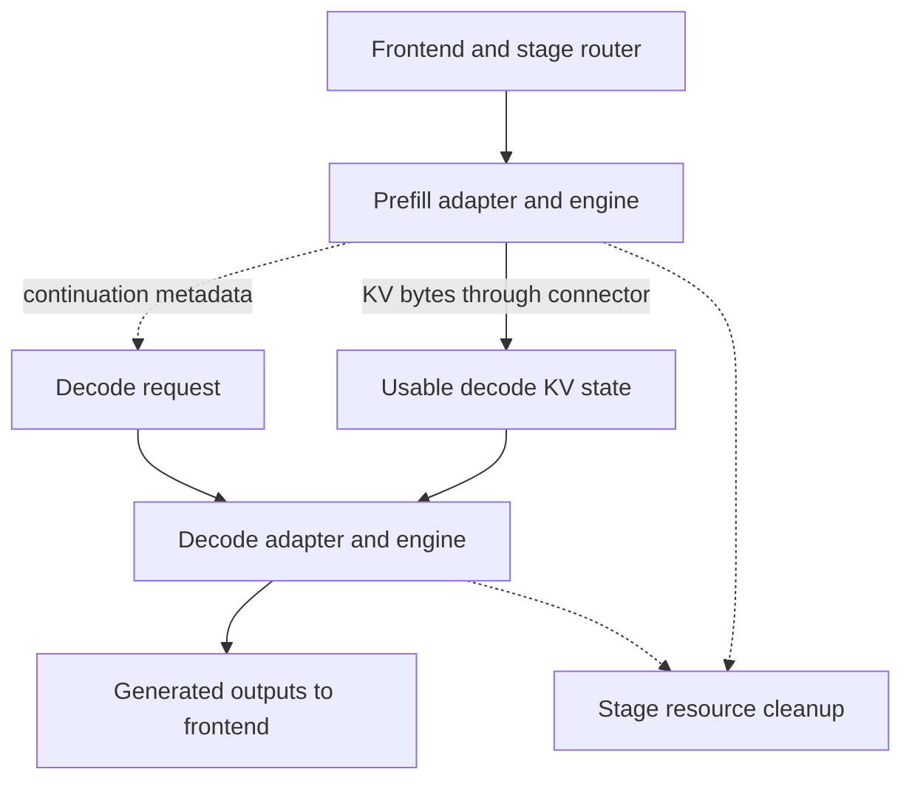

import Source from '../../../../components/Source.astro';

## Split two different kinds of model work

**Prefill** processes the prompt and produces attention state. **Decode** repeatedly extends the sequence to generate output tokens. Separating them into worker pools lets a service scale and place those workloads independently, at the cost of coordination and KV-state movement.

An aggregated worker handles both phases locally. Start there for the simplest request trace, then use disaggregation when the workload justifies separate capacity or latency control.

<Source project="dynamo" path="examples/backends/vllm/launch/disagg.sh" label="Disaggregated vLLM configuration" />

## Follow metadata and payload separately

Dashed handoff arrows carry control information. The solid KV edge carries tensor state through the configured connector. Required continuation metadata can become available before all stage cleanup has finished.

## Trace one handoff

The frontend's prefill router composes prompt processing with the decode leg. It chooses the stage route and preserves the request context and cleanup responsibilities across that composition.

The prefill adapter invokes the engine and returns engine-owned handoff parameters in `disaggregated_params`. The decode adapter interprets those parameters through its connector strategy and submits the continuation. Decode can execute dependent work once the required KV state is usable.

For the selected vLLM/NIXL path, the connector coordinates pulling prompt state from the prefill side. Other configured strategies can push state or reuse a shared cache. The orchestration boundary stays stable: stage control carries continuation intent, while the engine/connector integration provides the data-access contract.

<Source project="dynamo" path="lib/llm/src/kv_router/prefill_router/mod.rs" label="PrefillRouter composition" />
<Source project="dynamo" path="lib/llm/src/kv_router/prefill_router/handoff.rs" label="Handoff and decode continuation" />
<Source project="dynamo" path="components/src/dynamo/vllm/kv_connector_protocols.py" label="Engine connector strategies" />

## Completion includes resource ownership

A finished user stream can leave transfer or cleanup work outstanding. Source and destination KV allocations must remain valid while connector operations reference them. Remote prefill can also leave a cleanup obligation that still needs the selected decode worker even after a client disconnect.

The vLLM adapter includes a deferred-abort safeguard on its selected disaggregated decode path: it waits for first engine output before performing an abort that would otherwise interrupt an unsafe transfer window. The architectural lesson is that cancellation intent and safe resource release can happen at different times. The [cancellation chapter](/architecture/dynamo/cancellation-failure/) follows those owners.

<Source project="dynamo" path="components/src/dynamo/vllm/handlers.py" label="Prefill/decode handlers and lifecycle" />

## Decisions and code route

- **Split or aggregate:** compare independent scaling benefits with transfer and coordination costs.
- **Stage placement:** balance available prefill/decode capacity and useful state locality.
- **Connector strategy:** choose a supported path whose registration, transfer, and cleanup contracts match the engines.

Read launch roles, prefill-router composition, handoff construction, then the adapter's prefill output and decode input. Measure prompt compute, transfer/dependency waiting, and first-token delay at their actual boundaries when evaluating the split. The control-flow diagram explains where those costs arise; it supplies no assumed speedup.
