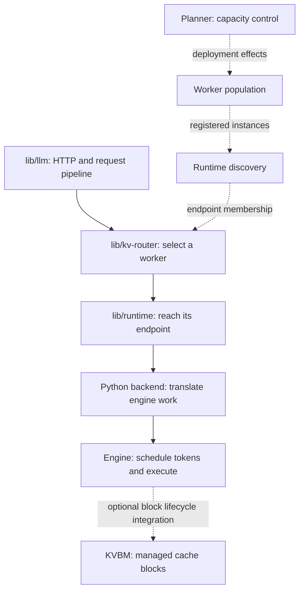

import Source from '../../../../components/Source.astro';

## Find the owner of the behavior

Dynamo spans several libraries and languages because serving has several owners. A useful first trace follows a request from the HTTP frontend to an engine worker and back. Once that path is clear, the cache and capacity-control subsystems become easier to place.

Use the vLLM integration as the concrete engine in this guide. Other adapters implement the same broad serving role with their own engine interfaces. The source tree is best read by responsibility rather than by programming language: both Python and Rust participate in request control.

<Source project="dynamo" path="README.md" label="Project organization and serving role" />

## The source map

Solid arrows follow the request. Discovery, capacity planning, and optional block management support that path with different kinds of state.

| Source family | What it owns |
| --- | --- |
| `lib/llm` | Public request handling, preprocessing, pipeline composition, output transformation |
| `lib/kv-router` | Worker selection, prefix indexes, reservations, routing-load accounting |
| `lib/runtime` | Addressable endpoints, service discovery, distributed request contexts |
| `components/src/dynamo/<engine>` | Engine startup, request translation, output projection, engine lifecycle |
| `components/src/dynamo/planner` | Observe capacity/demand and propose deployment changes |
| `lib/kvbm-*` and bindings | Optional KV block-management integration |
| `deploy` | Installation and deployment-controller integration |

A basic aggregated service uses only the pieces needed for its chosen path. Cache-aware routing can index engine caches independently of the optional KVBM block manager.

## Trace interfaces across the tree

The Python frontend entrypoint resolves configuration and starts the Rust-facing service. In dynamic serving, discovery supplies compatible model workers and the frontend constructs a model-specific pipeline. That pipeline preprocesses the request, invokes the selected routing/stage operators, and reaches a backend endpoint.

The adapter then calls its engine. The engine owns the worker's token scheduler and model execution. On the return path, the adapter translates engine results and the frontend builds the public response. Follow both directions: a correct engine result can still be transformed incorrectly before reaching the client.

Request definitions are useful landmarks between components. Read the preprocessed request and backend output types before chasing every helper called by the pipeline. They tell you which values cross the boundary and which component understands them.

## Choose a reading route

| Question | Start here | Continue into |
| --- | --- | --- |
| Why was a request rejected or formatted this way? | HTTP handler and preprocessing | Public request/output types |
| Why did this worker receive it? | Selection operation and run path | Cache lookup and load/accounting state |
| Why did model execution behave differently? | Selected engine adapter | Engine repository guide |
| Why did worker count change? | Planner tick and effect submission | Deployment environment/controller |

This keeps the main trace focused: select the component that made the decision, inspect its inputs, then cross the next explicit interface.

## Read the code

1. <Source project="dynamo" path="components/src/dynamo/frontend/main.py" label="Frontend entrypoint" /> and <Source project="dynamo" path="lib/llm/src/entrypoint/input/http.rs" label="HTTP service construction" /> establish the running service.
2. <Source project="dynamo" path="lib/llm/src/entrypoint/input/common.rs" label="Pipeline assembly" /> connects the request operators.
3. <Source project="dynamo" path="lib/llm/src/protocols/common/preprocessor.rs" label="PreprocessedRequest" /> and <Source project="dynamo" path="lib/llm/src/protocols/common/llm_backend.rs" label="BackendOutput" /> define the shared values.
4. <Source project="dynamo" path="components/src/dynamo/vllm/handlers.py" label="vLLM handlers" /> reaches the engine API.
