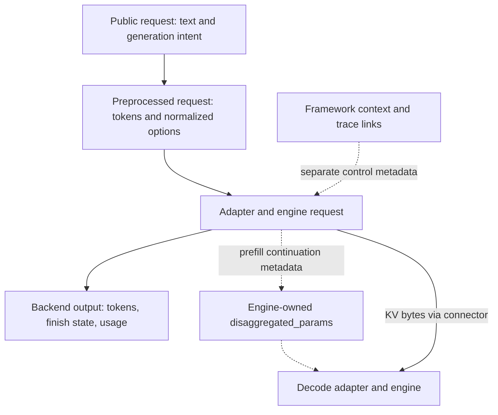

import Source from '../../../../components/Source.astro';

## Follow the request's representations

A client request, a preprocessed worker request, and an engine result describe different stages of one operation. Dynamo uses separate representations because the client speaks a public API, routing needs token-level work, and each engine has its own execution and handoff interface.

Trace the values that cross each boundary: prompt tokens, generation options, request identity, generated output, and any continuation metadata. This explains most of the protocol architecture without walking every optional field.

## Public request to worker work

The HTTP handler validates the public request and selects its model-specific engine pipeline. Preprocessing turns text or chat input into tokens and normalized generation/output options. `PreprocessedRequest` carries those inputs toward routing and the worker.

Prompt tokens use shared immutable storage for efficient local cloning:

```rust
pub token_ids: Arc<Vec<TokenIdType>>,
```

That sharing is local to the process. A remote call serializes the token values into the worker request. The worker engine separately allocates the KV state computed from them.

<Source project="dynamo" path="lib/llm/src/http/service/openai.rs" label="Public request handling" />
<Source project="dynamo" path="lib/llm/src/protocols/common/preprocessor.rs" label="PreprocessedRequest and prompt ownership" />

## Keep control metadata and KV bytes separate



The handoff field describes how the selected engine continues from prefill state. The configured connector moves the tensors; generic frontend code carries the engine metadata without inventing its format.

Dynamo keeps framework-owned fields such as tracing separate from engine-owned `disaggregated_params`. Frontend-local attempt and cleanup state can also remain local rather than becoming client-controlled request options. The reader should identify each field's owner before modifying its transformation.

## Backend output to public response

`BackendOutput` and `LLMEngineOutput` carry generated tokens, optional text, finish information, usage, and supported metadata. A stream item can contain control information without containing a new visible word. The adapter and backward frontend operators preserve that distinction while constructing client output.

Both streaming and nonstreaming HTTP requests use an internal stream. Streaming forwards projected increments; nonstreaming collects them into a final response. Completion and error handling therefore remain part of the protocol even when the client asks for one result.

<Source project="dynamo" path="lib/llm/src/protocols/common/llm_backend.rs" label="BackendOutput and LLMEngineOutput" />

## Decisions and source route

Three boundaries guide changes: public API policy belongs at the frontend, engine-specific translation belongs in the adapter, and opaque continuation formats belong to the selected engine/connector. Keep shared definitions small enough that each layer can maintain its own contract.

Read the public handler, `PreprocessedRequest`, backend output definitions, then the selected [adapter](/architecture/dynamo/backend-adapters/). For one important field, follow its assignments through that route. This is more useful than memorizing every optional member of the request structs.
