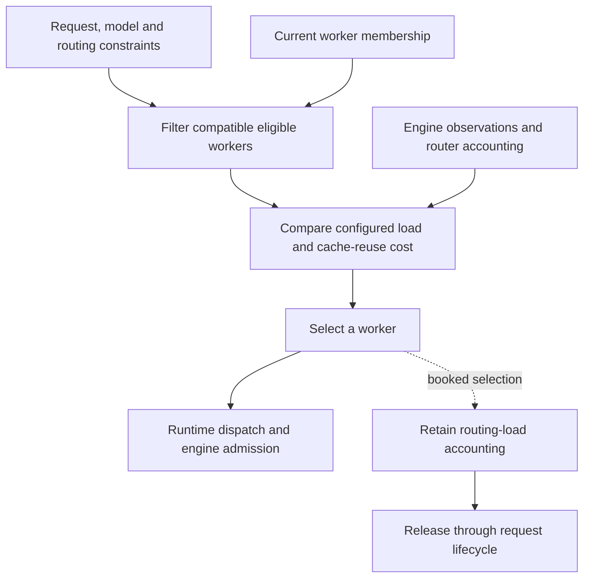

import Source from '../../../../components/Source.astro';

## Choose a worker, then account for the work

Several workers can serve the same model while having different queues and useful cached prefixes. Dynamo's router decides which compatible worker should receive a request. Its selection result can also create accounting state so the next decision sees work that has been routed but has not yet appeared in engine metrics.

The two questions are **where should this request go?** and **who records and releases its routing load?** Keeping both in the trace explains the selection architecture without enumerating every policy option.

## Follow the selection flow

Eligibility defines which workers can serve the operation. The policy compares the eligible set. A booking accounts for routed demand; the worker's engine still schedules its own token work.

<Source project="dynamo" path="lib/kv-router/src/services/selection/core/operation.rs" label="SelectionOperation and admission contract" />
<Source project="dynamo" path="lib/kv-router/src/services/selection/core/run.rs" label="Selection execution" />

## Inputs, membership, and policy

The normalized selection operation combines prompt information, expected output, request constraints, and configured policy. Membership supplies a compatible routing partition: model identity and cache/rank configuration influence which workers belong together.

Hard constraints can remove a worker before scoring. The remaining comparison can weigh load, prefix reuse, transfer cost, and affinity according to the configured policy. A strong cache match can be outweighed by a busy worker. This is the main reason to read eligibility and preference as separate steps.

Discovery updates membership while cache events and engine reports update observations. Router bookings fill part of the gap between dispatch and those later observations. These are cooperating views of state rather than one synchronous snapshot.

<Source project="dynamo" path="lib/kv-router/src/services/selection/core/workers.rs" label="Worker and partition state" />

## Understand the accounting contract

The selection API supports inspection without booking and selections that retain routing load. `Book` records a reservation managed by the core's lifecycle calls; `Lease` returns an armed booking handle to its caller. Query/advisory operations answer different inspection/admission questions without installing the same retained booking.

For example, R1 and R2 can arrive close together when A and B look equally loaded. Booking R1 on A lets R2 account for that work before A publishes fresh metrics. An inspection-only choice of A creates no equivalent retained load. On completion or cancellation, the owner must release any booking so future choices see accurate demand.

The reservation implementation handles construction and rollback. A newcomer should first locate the live booking's owner and release path; its guard internals are a later implementation detail.

<Source project="dynamo" path="lib/kv-router/src/services/selection/core/reservations.rs" label="Reservation ownership and lifecycle" />

## Decisions and code route

- **Eligibility:** which model/worker constraints must hold before comparing cost?
- **Placement:** which configured balance of reuse and load chooses among eligible workers?
- **Accounting:** is this an inspection or a booked dispatch, and who releases the booking?

Read operation types, worker membership, selection execution, then reservation lifecycle. The [cache-aware routing chapter](/architecture/dynamo/cache-aware-routing/) explains the cache evidence used by the comparison; the [engine guide](/architecture/vllm/) explains admission after dispatch.
