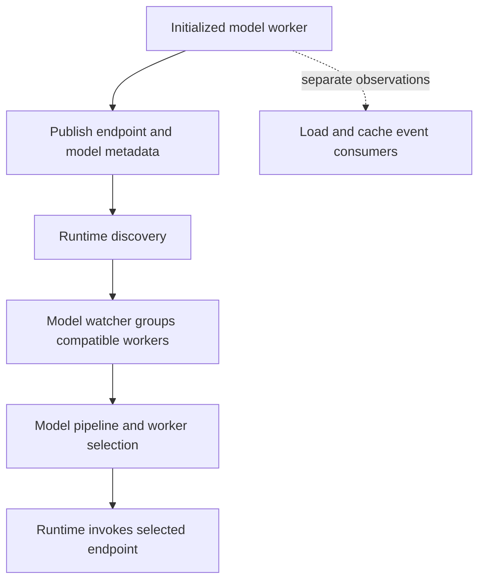

import Source from '../../../../components/Source.astro';

## Turn workers into callable services

The frontend needs to find a compatible model worker and reach its generate endpoint. Dynamo's runtime supplies endpoint identity, discovery, and the distributed call machinery. The model-facing watcher turns discovered workers into a serving configuration that the frontend can use.

A worker's identity includes its namespace, component, endpoint, and instance context. That structured identity lets several services and replicas coexist without reducing every lookup to a port number. The model metadata then determines which discovered workers belong in the same serving group.

<Source project="dynamo" path="lib/runtime/src/discovery/mod.rs" label="Discovery types and queries" />
<Source project="dynamo" path="lib/runtime/src/service.rs" label="Service and endpoint information" />

## Follow publication to selection

This is the dynamic serving path. Discovery supplies available endpoints; routing chooses among them using the configured policy and observations.

The frontend watcher reacts to worker membership and model information. It registers usable model engines with the model manager, making them available to public request handling. Model compatibility is an architectural gate: an endpoint being present is only useful to a request that its worker can actually serve.

<Source project="dynamo" path="lib/llm/src/discovery/watcher.rs" label="ModelWatcher" />
<Source project="dynamo" path="lib/llm/src/entrypoint/input/http.rs" label="Watcher integration with HTTP serving" />

## Keep registration ownership explicit

Registration has a lifecycle. The runtime's registration manager can share one published registration among several local users and retain it while they hold leases. Final release removes a registration that the manager owns. This allows cooperating local components to use an endpoint without each independently tearing down its shared publication.

For a newcomer trace, the important question is who keeps that publication alive. Detailed acquisition races belong in the registration implementation; they are not additional request-routing stages.

Runtime-local endpoint lookup is another useful boundary. An in-process registry can resolve local endpoint objects, while discovery communicates distributed membership. The two mechanisms serve different locations in the call path.

<Source project="dynamo" path="lib/runtime/src/discovery/registration.rs" label="Registration ownership and leases" />
<Source project="dynamo" path="lib/runtime/src/local_endpoint_registry.rs" label="Local endpoint registry" />

## Decisions that matter

- **Service and model identity:** determines which endpoints can participate in the request's serving group.
- **Discovery versus events:** membership updates answer who is available; cache/load events inform how desirable a worker is.
- **Registration lifetime:** the component holding the lease is responsible for keeping publication valid through use and releasing it on shutdown.

A practical diagnosis follows those boundaries. With no usable model, inspect publication and watcher admission first. With a discovered model but a failed call, continue into endpoint resolution and request transport. With successful calls but poor placement, move to the [selection chapter](/architecture/dynamo/routing-selection/) rather than continuing through discovery internals.

## Read the code

Start with discovery types, then worker registration, `ModelWatcher`, and the frontend's watcher integration. Inspect local endpoint lookup only when the selected call path stays in process. This gives a direct route from worker startup to the endpoint consumed by the request pipeline.
