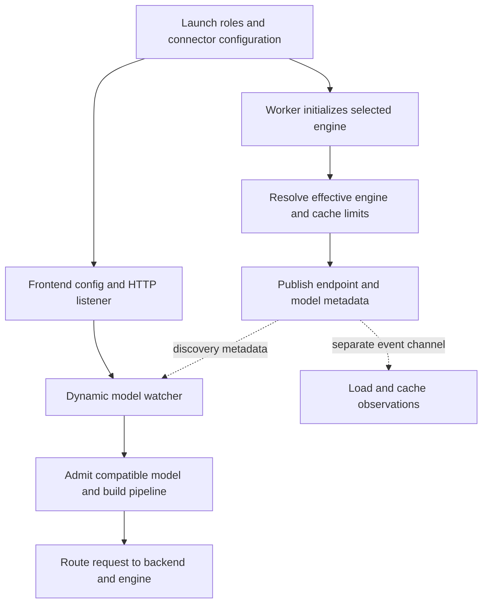

import Source from '../../../../components/Source.astro';

## Readiness is a joined path

Starting a service means bringing up a frontend and one or more usable model workers. The frontend can listen before a compatible worker is ready. A complete serving path needs an initialized engine, published worker metadata, and a frontend pipeline that can route to it.

The launch examples make the process roles concrete. Aggregated serving keeps prompt processing and generation together. The disaggregated example starts a frontend, a prefill worker, and a decode worker; its engine connector supplies the KV-transfer mechanism between stages.

<Source project="dynamo" path="examples/backends/vllm/launch/disagg.sh" label="Disaggregated vLLM launch example" />

## Follow the startup branches

The frontend and worker branches join through discovery. Cache/load reporting is a separate observation channel that later routing and planning can consume.

The frontend's Python entrypoint parses configuration and invokes the bound serving code. In the dynamic path, Rust constructs the HTTP service and runs a model watcher. As workers appear, the watcher groups compatible model metadata and makes the corresponding request pipeline available.

The worker takes a different route. Its backend builds the selected engine, obtains the engine's effective configuration, and publishes the endpoint and model information. Effective limits matter because device profiling and engine initialization can resolve different capacities from the operator's requested settings.

<Source project="dynamo" path="components/src/dynamo/frontend/main.py" label="Frontend startup" />
<Source project="dynamo" path="lib/llm/src/entrypoint/input/http.rs" label="Dynamic HTTP service and model watcher" />
<Source project="dynamo" path="components/src/dynamo/vllm/main.py" label="vLLM engine creation and publication" />

## What the worker publishes

The frontend needs enough information to treat workers as compatible serving candidates: model/tokenizer identity, supported capabilities, context limits, cache-block granularity, and rank-related configuration. The endpoint supplies the route to execute work; the metadata supplies the contract for that route.

For example, vLLM startup publishes usable KV-block and scheduling limits after engine initialization. Routing and capacity planning should reason from those effective values. A configured maximum in the launch command represents intent until the engine has resolved what it can provide.

Discovery and observation also have different jobs. Discovery makes the worker addressable. Load reports describe active work, and cache events describe reusable prefixes. Understanding startup does not require tracing every event format, but it does require keeping those responsibilities separate.

## Consequential startup choices

| Choice | Why it changes the trace |
| --- | --- |
| Aggregated or disaggregated workers | Determines whether a request crosses a prompt-state handoff |
| Dynamic workers or an in-process engine | Determines whether model availability comes through discovery |
| Engine and KV connector | Determines worker initialization and any transfer/block-management integration |

When startup stalls, locate the missing milestone: frontend listener, initialized engine, published worker, or admitted model pipeline. Follow that branch instead of treating every failure as an HTTP or GPU problem. The same ownership map guides shutdown: each component releases the resources it created, with engine/transfer work allowed to reach its safe retirement boundary.

## Read the code

Read the launch example, frontend entrypoint, HTTP construction, and selected backend startup in that order. The <Source project="dynamo" path="components/src/dynamo/common/backend/README.md" label="Common backend lifecycle" /> explains the shared initialize/generate/abort/drain/cleanup responsibilities. Use the [runtime chapter](/architecture/dynamo/runtime-discovery/) when the trace reaches worker publication and discovery.
