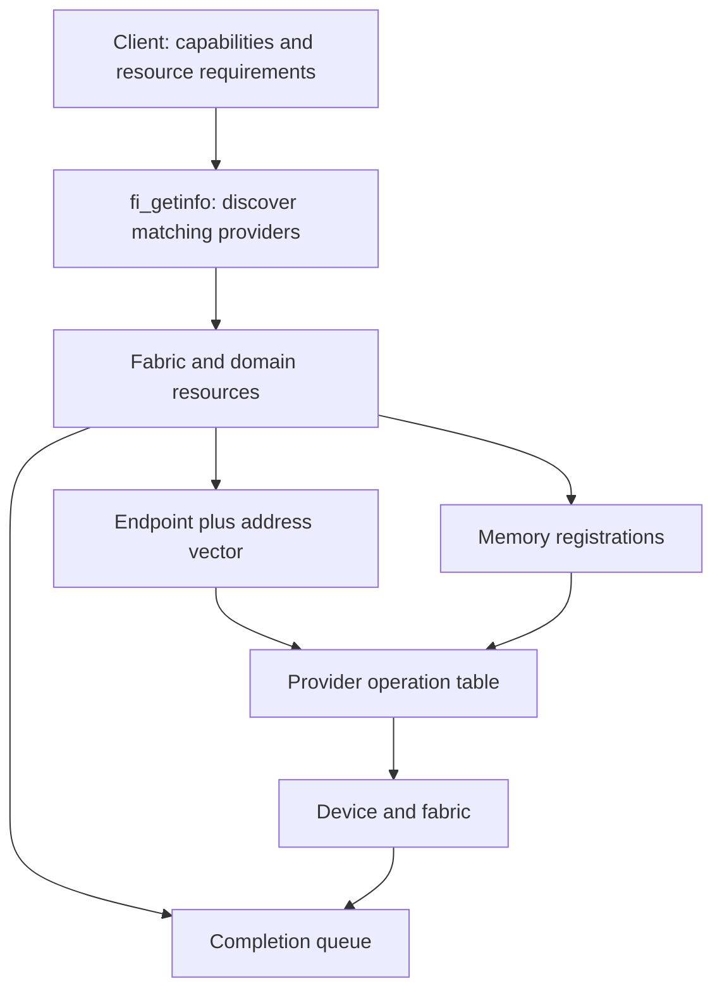

import SystemMap from '../../../components/SystemMap.astro';
import Source from '../../../components/Source.astro';

## Why it exists

Communication libraries need to move data across different networks without
implementing every adapter's API. libfabric supplies the **Open Fabrics Interfaces
(OFI)**: a common way to discover network services, create resources, submit work,
and observe completion. A **provider** implements those services over a particular
hardware or software path.

The application describes what it needs, then chooses a compatible configuration.
That negotiation is central to libfabric: different providers offer different
operations, memory access mechanisms, and completion guarantees.

## Where it fits

<SystemMap current="libfabric" />

In the selected AWS path, NCCL calls the AWS OFI NCCL plugin, which calls libfabric,
which dispatches to the Elastic Fabric Adapter (EFA) provider. libfabric supplies networking services; the
layers above choose collective algorithms and inference work. Other applications
can use it independently of NCCL.

## Architecture overview

Follow the resource and operation boundaries:

A **fabric** groups communication resources. A **domain** scopes a local device's
resources and memory rules. An **endpoint** submits operations. An **address
vector (AV)** maps peer addresses to local handles. A **memory registration (MR)**
describes allowed access to a memory range. A **completion queue (CQ)** reports
asynchronous outcomes.

The application owns resource setup and buffer lifetime. The provider owns the
implementation behind each operation table. This is the useful source boundary:
the public API names the contract, while the selected provider explains its cost
and implementation.

## Follow an operation

For a tagged message on EFA's protocol-based `efa` fabric:

1. Call `fi_getinfo` with required services and supported obligations. Select a
   compatible returned entry.
2. Open fabric/domain resources, create an endpoint, bind its CQ and AV, and
   enable it. Exchange peer addresses through the application's bootstrap path.
3. Prepare registration as required by the returned memory rules. Post a matching
   receive, then submit `fi_tsend` with payload, peer handle, tag and context.
4. The endpoint's tagged operation table dispatches to EFA. The provider selects
   a protocol, moves data and advances its state through progress calls.
5. Read completion or error entries and retire the corresponding request. Keep
   buffers and registrations valid until the applicable completion boundary.

An accepted send starts asynchronous work. Local completion and remote application
consumption are separate events; application coordination supplies the latter.

## Decision gates

| Choice | Architectural consequence |
| --- | --- |
| Endpoint and capabilities | Determine whether messaging, tagged matching, RMA or atomics are available. |
| Memory model | Determines registration, addressing and device-memory obligations. |
| Provider variant | EFA's `efa` supplies protocol-based services; `efa-direct` exposes a narrower path. |
| Progress and completion | Determine who advances accepted work and when memory can be reused. |

Start with [public contracts](/architecture/libfabric/public-api/) and
[negotiation](/architecture/libfabric/capability-negotiation/). The later EFA
chapters trace one provider implementation rather than treating its internals as
portable API requirements.

## Explore the code

Read discovery, public dispatch, then the selected provider:

<Source project="libfabric" path="src/fabric.c" label="Core discovery and provider selection" />
<Source project="libfabric" path="include/rdma/fi_tagged.h" label="Tagged operation dispatch" />
<Source project="libfabric" path="prov/efa/src/rdm/efa_rdm_msg.c" label="EFA RDM send path" />
<Source project="libfabric" path="prov/efa/src/rdm/efa_rdm_cq.c" label="EFA progress and completion" />
