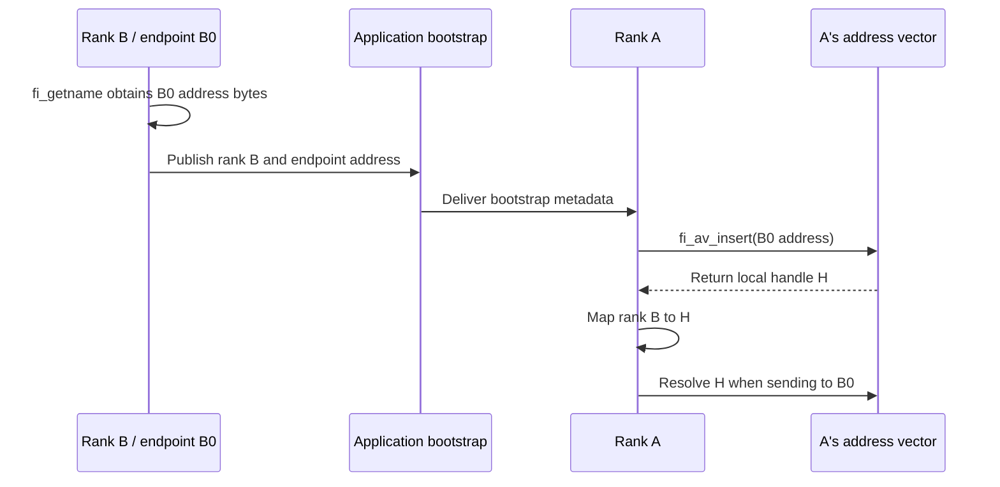

import Source from '../../../../components/Source.astro';

## Translate application identity into endpoint identity

An application knows peers as ranks or workers. libfabric operations need the
addressing identity of the selected peer endpoint. For connectionless-style
endpoints, an **address vector (AV)** maps exchanged endpoint addresses to local
`fi_addr_t` handles.

Keep three values separate: logical rank, raw endpoint address, and local AV
handle. A worker restart can preserve the rank while changing the endpoint
address, so an old handle cannot automatically name the replacement.

## Follow address exchange

The application obtains its endpoint address, commonly with `fi_getname`, and
exchanges those bytes through its bootstrap mechanism. Each process inserts its
peers into its own AV, checks insertion results, and stores the returned handles.
The framework maintains the rank-to-handle mapping used for submissions.

An AV handle is meaningful within that AV. Two processes can both receive handle
zero while referring to different peers. Exchanging raw addresses, rather than
assuming a shared handle namespace, establishes the correct relationship.

## Choose the endpoint's addressing model

The selected endpoint type determines setup:

| Model | Main setup path |
| --- | --- |
| Reliable datagram (RDM) or datagram | Exchange raw addresses, insert into an AV, then submit using local handles. |
| Connection-oriented FI_EP_MSG | Listen for connection requests, create/accept an active endpoint, and observe connection events. |

Within an AV, FI_AV_MAP returns opaque handles that the application stores.
FI_AV_TABLE defines insertion-order indices. Both representations remain local
to their AV and depend on keeping the corresponding entries valid.

EFA adds endpoint-specific peer state above its address mappings. Its raw address
includes device-related identity and QP information, allowing endpoints on the
same device to remain distinct. The RDM provider uses reverse lookup to associate
incoming packets with that peer state.

## Keep mappings live while work uses them

Before removing an AV entry, retire operations that reference it. During worker
replacement, coordinate membership recovery, address exchange and mapping updates
as one application action. A valid transport address and a current logical worker
identity must agree before new work is sent.

Remote-memory operations add another layer: the AV identifies the peer, while a
remote address and key identify authorized memory. Address exchange alone does
not establish remote memory access. The [RMA chapter](/architecture/libfabric/rma-and-atomics/)
traces those values separately.

## Read the code

<Source project="libfabric" path="man/fi_av.3.md" label="AV insertion, handle and removal contracts" />
<Source project="libfabric" path="man/fi_cm.3.md" label="Endpoint addresses and connection management" />
<Source project="libfabric" path="prov/efa/src/efa_av.h" label="EFA addresses and lookup structures" />
