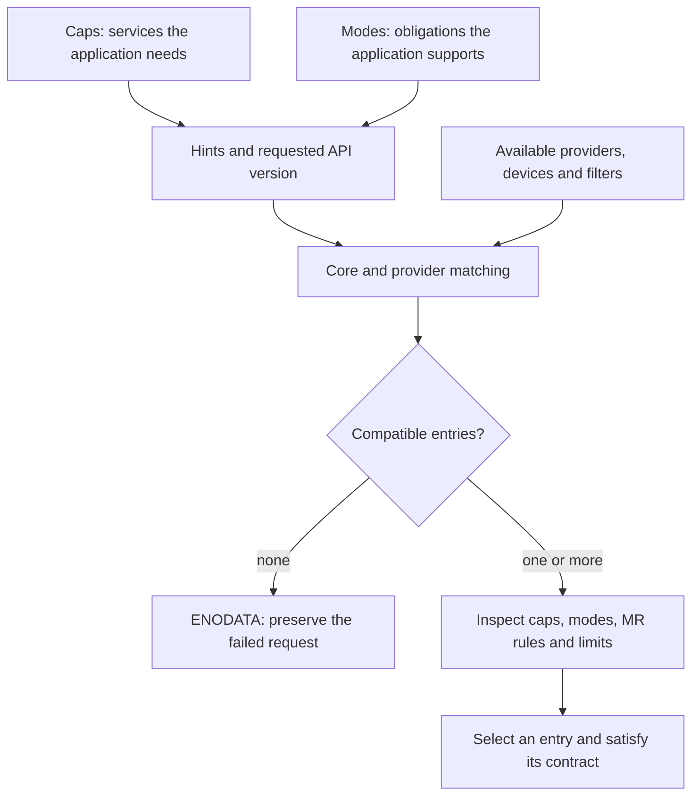

import Source from '../../../../components/Source.astro';

## Discovery chooses a contract

Finding an adapter is only the start. The application needs a service configuration
it can actually use: the right endpoint type, operations, memory rules and limits.
`fi_getinfo` matches that request against available providers and returns compatible
entries. The caller selects one and uses it to create resources.

This is the first decision boundary to inspect when startup fails. Packet-level
debugging comes later, after a usable endpoint exists.

## Services and obligations

**Capabilities** express services such as FI_TAGGED, FI_RMA or FI_HMEM. **Modes**
express obligations the application supports, such as retaining provider-usable
operation-context storage until completion. Returned mode requirements must be
honored by the caller.

The direction matters: asking for a service and promising an obligation are two
parts of the same negotiation. Advertising every mode merely to obtain a result
can select a configuration the application cannot safely implement.

Read each returned entry as a complete configuration, rather than checking only
its provider name. Result ordering expresses preference among compatible results.

## Follow the discovery path

The core initializes providers, checks API compatibility, applies selection and
layering filters, and invokes eligible providers' getinfo callbacks. It gathers
their results and performs final filtering. Individual providers can decline a
request while others still return usable entries.

The selected `fi_info` includes endpoint, transmit/receive, domain and fabric
attributes. For source tracing, record the following together:

| Attribute | Why it changes the implementation |
| --- | --- |
| Endpoint type and caps | Choose available operation semantics. |
| Modes and MR mode | Set context, buffer and registration obligations. |
| TX/RX limits | Bound outstanding work and the ranges in one operation. |
| Provider, fabric and domain | Identify implementation, variant and local resource scope. |
| API version | Selects the contract the caller implements. |

Preserve this returned configuration with runtime diagnostics. It connects the
application's intent to the endpoint implementation that later receives sends.

## One selection example

An application requiring tagged messages on EFA asks for a reliable-datagram
(RDM) endpoint with FI_EP_RDM and FI_TAGGED.
The protocol-based `efa` path can provide that service; the narrower `efa-direct`
path excludes tagged messaging. The important choice is therefore service
compatibility, even when both results belong to the same provider family.

Device memory adds another consequential requirement. FI_HMEM support and its
registration obligations must be negotiated before choosing a GPU transfer path.
The [device-memory chapter](/architecture/libfabric/heterogeneous-memory/) follows
that choice without treating capability discovery as proof of direct NIC access.

When no entry matches, preserve the original request and identify the unsatisfied
requirement. Relax a requirement only when the application can use the resulting
contract correctly.

## Read the code

<Source project="libfabric" path="man/fi_getinfo.3.md" label="Capabilities, modes and returned attributes" />
<Source project="libfabric" path="src/fabric.c" label="Core fi_getinfo dispatch and filtering" />
<Source project="libfabric" path="prov/efa/src/efa_prov.c" label="EFA configuration variants" />
