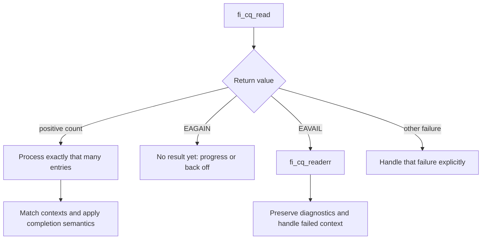

import Source from '../../../../components/Source.astro';

## Accepted work needs someone to advance and retire it

Asynchronous submission starts work that can remain active after the call returns.
A **completion queue (CQ)** connects later outcomes to application requests.
**Progress** advances the device and protocol work needed to reach those outcomes.
The selected domain defines the application's progress and threading obligations.

This is the return path of the architecture. Following only the send call leaves
buffer reuse, failure handling and resource release unexplained.

## Interpret CQ results before changing request state

A positive count identifies exactly the returned entries. EAGAIN reports no
ordinary result yet. EAVAIL directs the caller to `fi_cq_readerr`, where operation
context and diagnostic information identify the failed work.

Keep request context alive and use it to find the corresponding buffer and
ownership record. Completion can arrive in an order different from submission;
an aggregate count alone cannot identify which arbitrary buffer is now reusable.

The CQ format determines which fields are available, such as context, flags,
length or tag. Choose a format that supplies the evidence the application needs,
and retain other request metadata in the application's own record.

## Progress does protocol work

On EFA's protocol-based reliable-datagram (RDM) path, CQ progress integrates device polling with
endpoint/peer queues and protocol callbacks. Polling can advance transfers as
well as retrieve results. This explains why an application that stops entering
progress-capable calls can leave accepted work unfinished under manual progress.

A background progress design changes who performs that work. It still must honor
the domain's threading contract and leave application-level result handling to
the caller. Busy polling and supported waits are policies for driving and
observing progress; choose them after the dependencies are clear.

## Separate packet, operation and consumer completion

A device packet completion can release a packet or advance a protocol without
satisfying the requested public completion. For example, an EFA delivery-complete
send also depends on a remote receipt. Internal operation state can remain live
until every required reference is safe to release.

At the application boundary, apply the selected completion guarantee to local
buffer reuse. The remote consumer has its own lifetime and synchronization. That
distinction is especially important when a network receive feeds asynchronous
GPU computation.

Selective completion can suppress ordinary success entries. A caller using it
needs an explicit retirement scheme supported by its ordering/completion contract,
rather than assuming the absence of a CQ entry means immediate reuse.

## Read the code

Trace the public CQ read into provider progress and then the protocol callback:

<Source project="libfabric" path="man/fi_cq.3.md" label="CQ formats, results and error handling" />
<Source project="libfabric" path="prov/efa/src/rdm/efa_rdm_cq.c" label="EFA device polling and protocol progress" />
<Source project="libfabric" path="prov/efa/src/rdm/protocols/efa_rdm_proto_eager.c" label="Packet events and requested send completion" />
