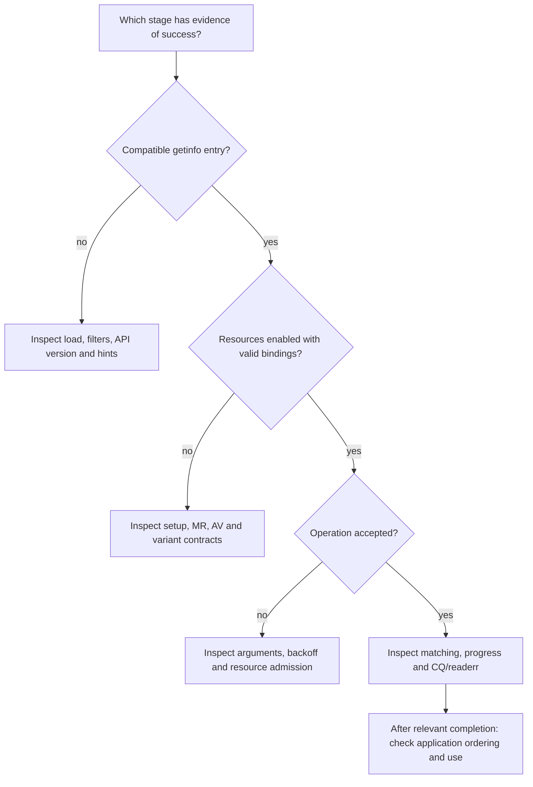

import Source from '../../../../components/Source.astro';

## Diagnose the first failed boundary

An OFI failure can arise during discovery, resource setup, admission, protocol
progress or application consumption. Start with the earliest stage lacking
evidence of success. That identifies the owner and source path to inspect.

The graph is an investigation order. A return code narrows the stage; the selected
configuration and retained request state explain the cause.

## Establish the implementation and contract

Record the loaded libfabric/provider identity, requested services and selected
`fi_info`. Keep endpoint type, fabric variant, memory rules, progress model and
relevant limits together. They connect runtime behavior to the implementation
being read.

For example, tagged messaging requested together with a forced `efa-direct`
variant is a service mismatch. The useful investigation is discovery and matching,
before any payload path exists. A broader diagnostic query can reveal available
alternatives; the application must still choose one that meets its requirements.

## Trace one request through acceptance and completion

For setup failure, inspect resource creation, bindings and enablement. For a
submission retry, inspect peer readiness, finite operation/packet capacity and
whether existing work is progressing.

Once work is accepted, retain its context and inspect its matching and CQ path.
Repeated EAVAIL means an error entry needs `fi_cq_readerr`, rather than more empty
polling. Preserve the provider's diagnostics along with the application request.

An unmatched tagged message gives another compact example: check the tag/mask,
intended receive and AV identity before descending into retransmission internals.
Those fields define what the application asked the provider to match.

## Separate correctness from mechanism and useful work

A GPU buffer can transfer correctly through a supported staging path while an
assumption about direct access is wrong. Equal-sized messages can choose different
protocols because memory access or completion requirements differ. Identify the
selected path before interpreting performance counters.

Likewise, a network completion can be correct while an application consumes the
wrong slot or starts a GPU consumer too early. Carry the trace through buffer
retirement and the higher-level consumer dependency. Each layer supplies its own
part of the ordering contract.

## Keep a short incident record and source route

A useful report contains the selected configuration, peer/memory identities,
operation length and context, submission outcome, completion/error evidence and
current owner of retained resources. That is enough to attach deeper diagnostics
to a concrete operation rather than an unbounded list of possible options.

Read in the same order:

<Source project="libfabric" path="src/fabric.c" label="Discovery and selected provider" />
<Source project="libfabric" path="prov/efa/src/rdm/efa_rdm_msg.c" label="Admission and message state" />
<Source project="libfabric" path="prov/efa/src/rdm/efa_rdm_proto.c" label="Selected transfer mechanism" />
<Source project="libfabric" path="prov/efa/src/rdm/efa_rdm_cq.c" label="Progress and completion/error path" />

The linked upstream tests can help investigate a particular boundary after the
main trace is understood. Hardware-dependent transfer tests remain a separate
step from reading the source.
