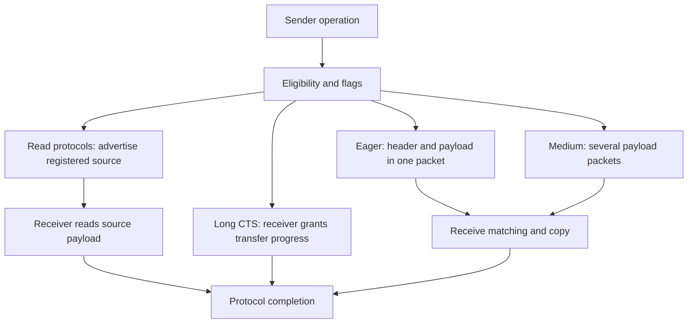

import Source from '../../../../components/Source.astro';

## One message API, several movement mechanisms

An application submits an EFA RDM message through the same OFI interface while
the provider chooses how to move its payload. Protocol choice changes copies,
registration needs, packet resources and completion work.

Message size is an input, but memory accessibility, peer capabilities and requested
completion semantics also matter. Trace this decision after identifying the
selected endpoint and operation.

## Compare the protocol families

**Eager** places a small payload alongside its request header. **Medium** carries
one logical message across several payload packets. **Read protocols** advertise
accessible source ranges so the receiver can pull data; runt-read also carries an
initial payload portion. **Long CTS** uses a clear-to-send exchange in which the
receiver grants transfer progress.

The graph compares mechanisms rather than every packet or acknowledgment. Public
message/context identity survives those different wire paths.

## Follow selection into construction

`efa_rdm_msg_generic_send` first attempts the refactored protocol selector. That
selector tests its ordered candidates and selects the first eligible one. Generic
send retains an older fallback path, so begin at the current generic entrypoint
when navigating source rather than assuming the legacy selector is the whole
implementation.

The selected protocol supplies construction and completion methods. Construction
creates the TX operation's packet work and captures the descriptors needed by
the transfer. A read-based path needs accessible registration for every source
range it advertises. Selection and construction can therefore acquire resources
as well as choose a name.

## The choices that materially change the path

| Question | Effect on payload movement |
| --- | --- |
| Does the payload fit an eager request after headers? | Enables the compact single-request path. |
| Can the peer read all source ranges through the supported access mechanism? | Enables receiver-driven read protocols. |
| What completion does the caller request? | Can exclude a candidate or add receipt-dependent completion. |
| What peer/configuration is active? | Defines supported protocols and their effective thresholds. |

These are the useful decision gates for an architecture trace. Exact thresholds,
per-interface restrictions and diagnostic force options remain in the linked
selector and predicates.

## Follow completion at the operation level

A medium message can have several packet completions but one application context.
A delivery-complete operation can need a remote receipt in addition to local
device events. Keep packet release, requested public completion and final TX
operation retirement separate while reading callbacks.

That distinction also guides performance analysis: payload bytes, packet count,
device work requests and public completions measure different parts of a path.
Compare the mechanism actually selected, rather than interpreting every counter
as a count of logical messages.

## Read the code

<Source project="libfabric" path="prov/efa/src/rdm/efa_rdm_msg.c" label="Generic send and fallback boundary" />
<Source project="libfabric" path="prov/efa/src/rdm/efa_rdm_proto.c" label="Protocol selection and shared lifecycle" />
<Source project="libfabric" path="prov/efa/src/rdm/protocols/efa_rdm_proto_eager.c" label="Compact eager construction and completion example" />
<Source project="libfabric" path="prov/efa/src/rdm/protocols/efa_rdm_proto_longread.c" label="Read-path source registration and eligibility" />
