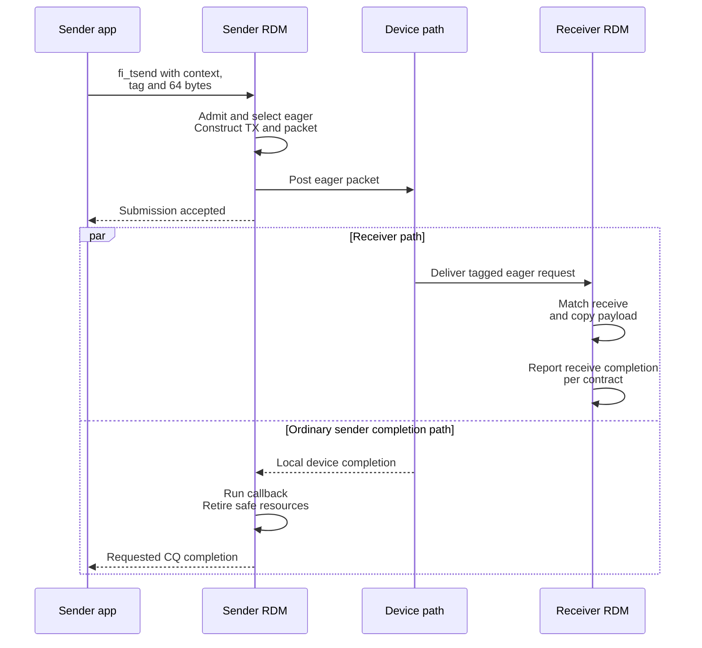

import Source from '../../../../components/Source.astro';

## Trace one ordinary eager send

Follow a 64-byte host-memory tagged message on an enabled protocol-based `efa`
reliable-datagram (RDM) endpoint. The peers have exchanged addresses, the receiver has posted a
matching receive, and the operation requests ordinary transmit completion.
Required buffers, descriptors and contexts remain live throughout the operation.

This example connects the earlier chapters: public dispatch chooses an
implementation, admission acquires state, a protocol moves data, and completion
returns ownership to the caller.

## See both ends without inventing a global completion order

The parallel branches show independent sender and receiver observations. Sender
completion authorizes the selected local reuse behavior; the receive side still
has its own matching, completion and consumer lifetime.

## Follow the main handoffs

**Public API to provider.** `fi_tsend` reaches the endpoint's tagged operation
table. For the chosen network path, the RDM wrapper enters generic send with the
payload, destination, tag and application context.

**Admission to protocol.** Generic send resolves the peer, checks finite resources
and acquires a TX operation entry. The selector chooses eager for this small
message, then construction captures its request information and builds an eager
packet with header, payload and callback.

**Device to receiver.** The send helper posts device work. Receiver progress
dispatches the incoming request, matches its tag/source to the posted receive,
copies the payload and accounts for receive completion. An early arrival can
instead wait in unexpected-message state until its receive is available.

**Device to sender callback.** Sender CQ progress polls the device event and
invokes the packet callback. For ordinary eager transmit completion, it reports
the requested application outcome and releases provider state when safe.

The application context, TX operation and packet are separate objects. The
context connects the CQ entry to caller bookkeeping; the TX operation retains
logical message state; the packet represents one piece of device work.

## Understand the two important variations

Requesting **delivery-complete** semantics extends the protocol with remote receipt
requirements. The local send event alone is then insufficient for the requested
public completion, and operation state survives until its release conditions hold.

A **failure** returns through the same owners. Rejected work must not remain
counted as accepted, and constructed packet/operation resources must be released
consistently. When tracing an error, follow ownership back through construction
and admission rather than treating every failure as lost network traffic.

These variations change retirement and reporting. They do not change the basic
architecture of dispatch, retained operation state, device progress and callbacks.

## Read the code in operation order

<Source project="libfabric" path="prov/efa/src/rdm/efa_rdm_msg.c" label="Tagged wrapper and generic send" />
<Source project="libfabric" path="prov/efa/src/rdm/efa_rdm_proto.c" label="Selection and TX construction" />
<Source project="libfabric" path="prov/efa/src/rdm/protocols/efa_rdm_proto_eager.c" label="Eager packet and completion callback" />
<Source project="libfabric" path="prov/efa/src/rdm/efa_rdm_pke_rtm.c" label="Receive matching" />
<Source project="libfabric" path="prov/efa/src/rdm/efa_rdm_cq.c" label="Device polling and callback dispatch" />
