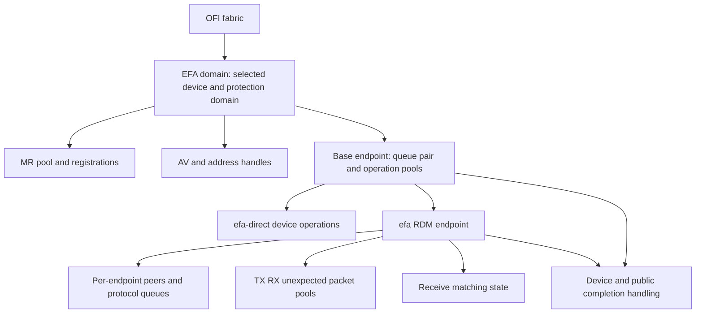

import Source from '../../../../components/Source.astro';

## Follow the selected EFA endpoint family

EFA implements several service variants. The protocol-based `efa` reliable-datagram (RDM) path adds
matching, packet protocols and peer state over device-facing resources.
`efa-direct` exposes a narrower path. The selected returned configuration tells
you which implementation to follow.

This chapter connects the portable resource model to the provider structures
that own real queue, packet and operation capacity.

## A shared base with protocol-specific state

The domain holds the selected device and protection/registration scope. Base
endpoint resources provide the device-facing queue and operation foundation.
The RDM extension adds per-peer protocol state, packet pools, matching and queued
work. This is a source reading map; individual allocations depend on the selected
variant and configuration.

A shared provider name or embedded base structure therefore does not make all
endpoint paths identical. Start at domain/endpoint construction and follow the
tables installed for the selected variant.

## Follow one send through its resource owners

The generic RDM send path resolves the destination peer, checks admission capacity,
and acquires a TX operation entry. Protocol selection constructs the state needed
for that logical message. The operation can then post device work or remain
queued until its peer handshake prerequisite is ready.

Three resource layers are useful to keep visible:

| Resource | What it retains |
| --- | --- |
| Application allocation and MR | Payload storage and valid network access |
| TX operation | Logical message, context, peer and protocol progress |
| Packet entry | Provider packet/header or staging state for part of the operation |

One operation may use several packets. Releasing one completed packet need not
finish the logical message; finishing the message need not destroy a shared
registration or endpoint.

## Decisions that explain behavior

**Variant:** choose the service contract before interpreting resource use. RDM's
protocol queues and matching do not describe every direct operation.

**Admission versus transfer:** finite packet/operation pools and peer readiness
can delay or reject a send before useful payload traffic. EAGAIN is a reason to
inspect progress and resource ownership, rather than assuming a saturated link.

**Sharing and concurrency:** device/domain resources can serve multiple endpoints,
while peer and packet state may be narrower. Account at the owning scope and
honor the selected threading model.

These boundaries lead naturally into [protocol selection](/architecture/libfabric/efa-message-protocols/)
and the [operation trace](/architecture/libfabric/efa-operation-trace/): first know
which object owns state, then follow how an event advances or releases it.

## Read the code

<Source project="libfabric" path="prov/efa/src/efa_domain.c" label="Domain creation and endpoint selection" />
<Source project="libfabric" path="prov/efa/src/efa_base_ep.c" label="Base endpoint resources" />
<Source project="libfabric" path="prov/efa/src/rdm/efa_rdm_ep.h" label="RDM protocol resources and queues" />
<Source project="libfabric" path="prov/efa/src/rdm/efa_rdm_msg.c" label="Admission and send operation construction" />
