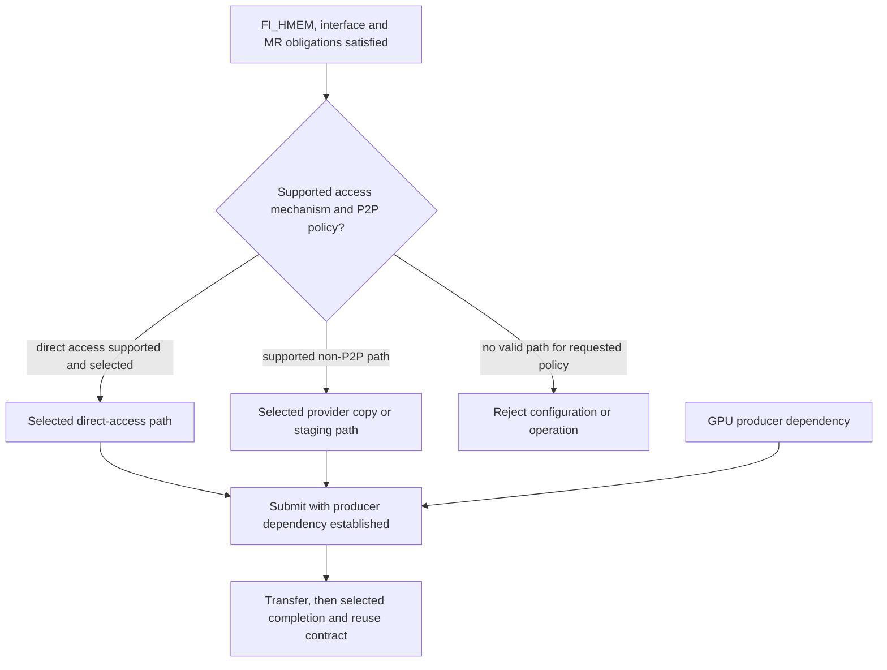

import Source from '../../../../components/Source.astro';

## Device-memory access is a separate capability

**Heterogeneous memory (HMEM)** includes accelerator allocations such as GPU
memory. libfabric can expose those buffers to supported operations, but a GPU
pointer alone does not choose a valid network access path.

Three responsibilities meet here: the application negotiates services, the
provider establishes access to the allocation, and the accelerator/framework
orders producer and consumer computation.

## Join access readiness with producer readiness

The graph shows prerequisites, rather than a required ordering between
registration and GPU execution. A valid access path and ready producer data must
both be established before communication uses the payload.

FI_HMEM advertises the device-memory service. FI_MR_HMEM specifies related
registration obligations. Explicit registration uses the appropriate interface
and device attributes; the returned configuration determines how the caller
supplies access information to operations.

Registration establishes access. The surrounding framework supplies the
dependency from the kernel producing a tensor to communication reading it, and
from completed receive work to a GPU consumer.

## Direct access or staging

**Peer-to-peer (P2P)** access lets the selected device path access accelerator
memory directly. A supported staging path copies through another memory type or
uses provider copy facilities. The distinction changes copies, registration cost
and synchronization, even when both paths deliver the same bytes.

EFA tracks memory-interface initialization separately from device P2P support.
That separation is useful when tracing performance: a working device-memory
operation may use a supported copy path rather than direct NIC access.

The provider and interface determine which alternatives exist. Applications can
express a P2P policy, but the selected hardware, build and allocation registration
must support it. Discovery is followed by actual registration and transfer work.

## Follow one GPU send

1. Select a configuration supporting the device-memory service and implement its
   registration rules.
2. Establish the producer dependency for tensor X and valid provider access to X.
3. Submit the operation; the provider uses its supported direct or staging path.
4. Observe the selected completion before reusing the source. The receiver
   separately establishes its consumer dependency before computing on the data.

During allocator reuse or model sleep/wake, connect registrations to allocation
lifetime. Mapping changes must be coordinated with active transfers and the
negotiated MR rules. Pointer equality alone is insufficient to reuse stale access
state.

When evaluating an optimization, check both payload correctness and the selected
mechanism. This distinguishes an application using GPU memory successfully from
one actually achieving its intended direct-transfer path.

## Read the code

<Source project="libfabric" path="man/fi_mr.3.md" label="Device memory and registration obligations" />
<Source project="libfabric" path="prov/efa/src/efa_hmem.c" label="Interface initialization and P2P policy" />
<Source project="libfabric" path="prov/efa/src/efa_mr.c" label="Allocation registration and interface validation" />
