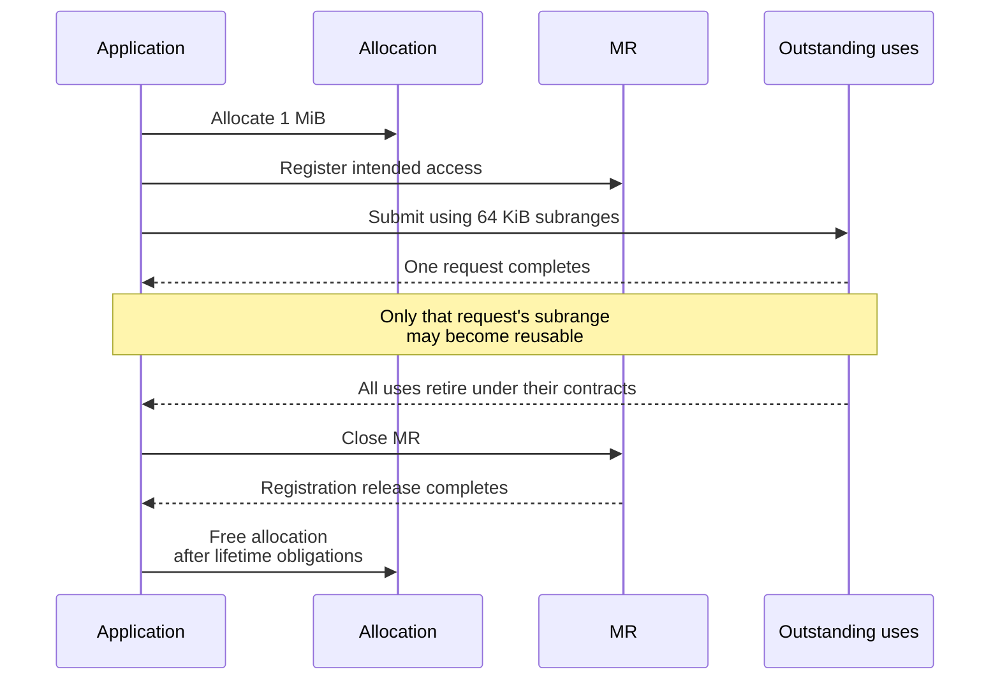

import Source from '../../../../components/Source.astro';

## Registration connects an allocation to network access

A **memory registration (MR)** describes a range and its permitted access to the
provider. It can establish device mappings and produce information used by local
or remote operations. The application still owns the allocation and coordinates
when those operations may use it.

For inference systems, registration is often amortized over a tensor or buffer
pool. The important architecture is the relationship between allocation,
registration and outstanding requests.

## Two consumers of registration information

`fi_mr_desc` provides a local descriptor for operations using local registered
memory. `fi_mr_key` supplies remote authorization information under the selected
key model. The application exchanges remote address/key information with peers
while retaining local handles and descriptors itself.

Keep these roles separate in a buffer wrapper: allocation owner, MR handle, local
descriptor, remote access information, and outstanding uses. That structure makes
the lifetime explicit even when an allocator or RAII class hides cleanup.

## Follow one registered pool

Suppose a 1 MiB allocation supplies several 64 KiB request buffers:

One request completing can make its subrange reusable under its contract. The
whole MR remains live for other users. Closing the pool's registration requires
retiring its local and remote uses; allocation release then follows the selected
registration lifetime rules.

A provider registration cache can retain underlying hardware state after an
application reference is released. That improves reuse cost while preserving the
application's obligation to track valid handles and active transfers.

## The returned memory model determines responsibilities

Read `domain_attr->mr_mode` before designing a pool:

| Responsibility | Relevant rule |
| --- | --- |
| Local registration | FI_MR_LOCAL determines explicit registration obligations for local buffers. |
| Remote addressing | FI_MR_VIRT_ADDR selects virtual addresses rather than zero-based offsets. |
| Key assignment | FI_MR_PROV_KEY assigns keys through the provider. |
| Mapping stability | FI_MR_ALLOCATED requires preserving registered page mappings. |
| Device allocations | FI_MR_HMEM adds device-memory registration obligations. |

These rules describe different parts of access and can combine. In particular,
mapping updates supported for a still-live MR are different from reusing a closed
MR's descriptor. Reallocating at the same virtual address does not revive a closed
registration. Coordinate allocator changes with outstanding traffic.

## Follow EFA's registration boundary

EFA validates the requested range and memory interface, then constructs the device
registration. Its RDM implementation also has an internal cache for implicit
registrations. Cache references may share the same underlying entry, so their
release follows reference counting rather than a one-handle/one-device-object
assumption.

Read those implementation details when a registration cost or lifetime question
requires them. The main application invariant stays simple: valid access state
must outlive every operation that uses it.

## Read the code

<Source project="libfabric" path="man/fi_mr.3.md" label="MR modes, descriptors, keys and lifetime" />
<Source project="libfabric" path="prov/efa/src/efa_mr.c" label="EFA registration validation and device path" />
<Source project="libfabric" path="prov/efa/src/rdm/efa_rdm_mr.c" label="RDM registration-cache references" />
