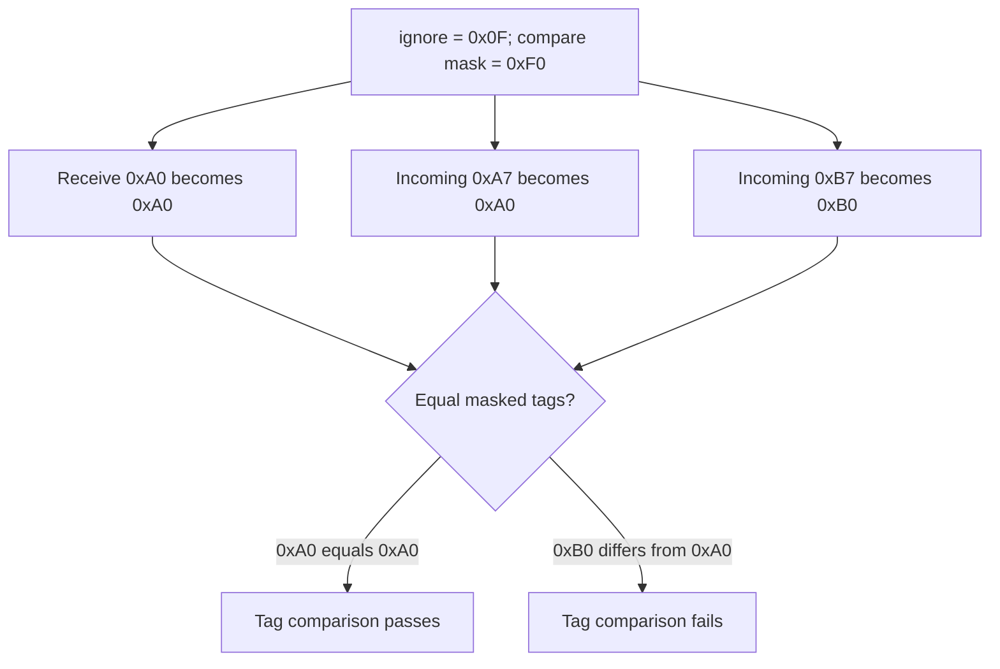

import Source from '../../../../components/Source.astro';

## A tagged receive connects bytes to an application purpose

Ordinary messaging matches a send to a receive. Tagged messaging adds a tag and
ignore mask so the application can distinguish logical channels or work items on
one endpoint. The peer address chooses where to send; the tag helps the receiver
choose which posted buffer accepts the message.

The application owns that matching protocol. The provider implements the posted
receive and unexpected-message machinery, then reports the selected completion.

## Understand one matching example

The receive mask excludes bits from comparison:

```c
(send_tag & ~ignore) == (recv_tag & ~ignore)
```

For an illustrative eight-bit tag, receive `0xA0` with ignore `0x0F` accepts `0xA7`
and rejects `0xB7`:



Only the high nibble matters in this example. The endpoint's negotiated tag format,
source restrictions and ordering complete the matching contract. Design distinct
tag ranges intentionally when several application protocols share an endpoint.

## Follow an ordinary message

The receiver posts a matching buffer and context. The sender submits its payload,
destination handle and tag. The provider selects a transfer protocol, moves the
payload into the receive operation, and produces completion/error outcomes for
the participating requests.

A message arriving before its receive may use an **unexpected-message** path.
That path retains finite provider state until a receive can match it. Receive
posting cadence therefore affects resource use and progress, even on a healthy
network.

Keep receive storage valid until its completion boundary. On the sender, ordinary
asynchronous submission also retains source lifetime through the selected local
completion contract. The application's consumer owns the payload after receive
completion and may keep it much longer.

## Decisions that change the path

**Matching design:** choose tags, masks and supported source restrictions that
identify the intended work. Overlapping receive patterns require deliberate
ordering assumptions.

**Ordinary send or inject:** inject copies a sufficiently small supported payload
into provider-owned storage by return, changing source reuse. Use the endpoint's
returned inject limits and supported memory types to decide whether it applies.

**Receive buffering:** early sends can consume unexpected resources; posting
receives ahead of work can reduce that pressure. Resource exhaustion first calls
for examining matching and progress, rather than increasing every queue limit.

On EFA's `efa` path, tagged wrappers feed the shared RDM message machinery. The
same public matching contract can use different payload protocols; the
[protocol chapter](/architecture/libfabric/efa-message-protocols/) explains that
provider choice.

## Read the code

<Source project="libfabric" path="man/fi_tagged.3.md" label="Matching and buffer-lifetime contract" />
<Source project="libfabric" path="include/rdma/fi_tagged.h" label="Tagged send/receive arguments and dispatch" />
<Source project="libfabric" path="prov/efa/src/rdm/efa_rdm_msg.c" label="EFA tagged wrappers and shared send path" />
