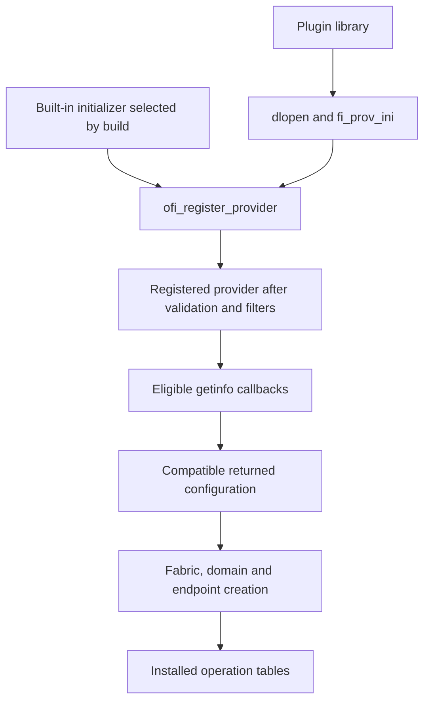

import Source from '../../../../components/Source.astro';

## From an installed provider to a selected implementation

A provider must be available to the loaded libfabric library, initialize, and
return a configuration matching the application. Those stages explain why an
installed source directory or plugin file alone does not identify a running
application's data path.

The core manages discovery and registration. The selected provider implements
fabric, domain and endpoint creation, which installs the tables used by operations.

## Loading paths converge at registration

Built-in providers use initializers selected by the build. Dynamic providers are
loaded as libraries, their initializer is resolved, and the resulting provider
structure enters the same registration machinery:



Registration validates the provider interface and applies filters. Discovery then
asks eligible registered providers for compatible information. Keeping loading,
registration and matching separate makes startup diagnosis much more direct.

## Follow construction into dispatch

For EFA, the provider structure names the main entrypoints:

```c
.getinfo = efa_getinfo,
.fabric = efa_fabric,
```

After discovery selects a variant, fabric/domain/endpoint creation installs its
resource and operation tables. A later `fi_tsend` dispatches through the endpoint's
tagged table. Trace that assignment before reading a convenient send function:
different endpoint variants can share a provider name while exposing different
operations and protocols.

Provider names can also describe a composed path. A **utility provider** can add
semantics over a lower-level provider, introducing its own buffering and progress.
The EFA RDM trace in this guide follows EFA's own protocol implementation; its use
of common helper code does not itself select an external utility layer.

## Choices that matter when tracing

First establish the loaded library/plugin identity, then the selected returned
provider, fabric and domain. Those names answer different questions: which
implementation family, which service variant, and which local resource scope.
Retain them together when comparing runtime behavior with source.

For an empty discovery result, investigate in order: implementation availability,
initialization/device access, filters, then exact requested services. That ordering
separates a missing implementation from a valid provider declining an incompatible
request.

Resource cleanup follows a different scope. Closing an endpoint releases that
application resource; it does not unload the provider for every user. Parent and
shared resources remain subject to their own live users.

## Read the code

<Source project="libfabric" path="src/fabric.c" label="Initialization, registration, loading and discovery" />
<Source project="libfabric" path="prov/efa/src/efa_prov.c" label="EFA provider entrypoints" />
<Source project="libfabric" path="include/rdma/fi_endpoint.h" label="Resource creation and control dispatch" />
