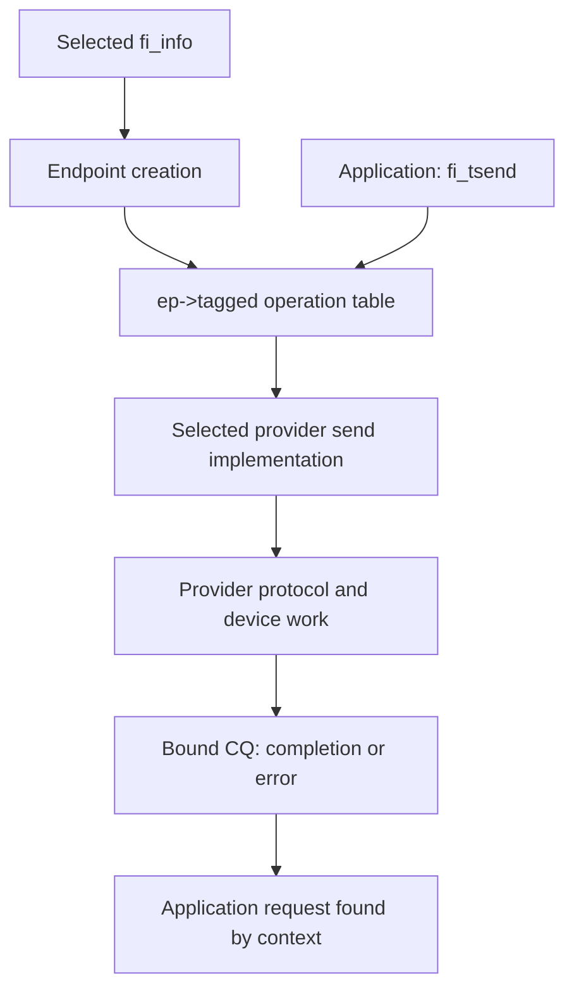

import Source from '../../../../components/Source.astro';

## Start with the service the caller needs

libfabric gives applications and communication libraries a vocabulary for network
services. A caller can request tagged messages or remote-memory access without
building device queues itself. The provider supplies the implementation, while
the caller chooses a configuration and follows its resource and memory rules.

Three stages organize the API: discover a service, create its resources, then
submit and complete operations. Start there when tracing a communication library
such as AWS OFI NCCL.

## The objects in one operation

| Object | Role |
| --- | --- |
| `fi_info` | Returned service configuration and limits |
| Fabric and domain | Resource scope and local device/memory rules |
| Endpoint | Interface through which work is submitted |
| AV handle | Local reference to a peer endpoint |
| MR descriptor | Local memory access information |
| Operation context and CQ | Connect an asynchronous outcome to the caller's request |

The endpoint uses these resources together, but their lifetimes remain distinct.
A domain can serve several endpoints, and an allocation can outlive individual
operations and registrations. The [resource chapter](/architecture/libfabric/resource-hierarchy/)
shows those relationships.

## Follow the selected operation table

The same public wrapper can reach different provider implementations:



For example, the essential dispatch in `fi_tsend` is:

```c
return ep->tagged->send(ep, buf, len, desc, dest_addr, tag, context);
```

The buffer and descriptor identify local payload access, the AV handle identifies
the peer, and the tag participates in receive matching. The context identifies
local request state when completion arrives. To find the real implementation,
follow where endpoint creation installed `tagged->send`.

## Trace setup through completion

The application calls `fi_getinfo`, selects a returned entry, opens its fabric and
domain, creates the endpoint, and binds the required addressing/completion
resources. After enablement and peer-address exchange, it can post receives and
submit sends.

Submission success means accepted work. A temporary resource shortage can require
progress and retry. Accepted work later produces the selected completion or error
outcome, which the caller associates with its retained context. Buffers stay valid
through that operation's completion contract; remote consumption may need an
additional application-level acknowledgment.

Two choices deserve attention before the first send: **capabilities** describe
services the application requires, while **modes** describe obligations it can
support. The returned configuration also defines registration and progress rules.
These are part of the interface the caller implements, rather than tuning hints.

## Read the code

Read the public types, discovery contract, and one operation wrapper before
entering provider internals:

<Source project="libfabric" path="include/rdma/fabric.h" label="Objects and capabilities" />
<Source project="libfabric" path="man/fi_getinfo.3.md" label="Discovery contract" />
<Source project="libfabric" path="include/rdma/fi_tagged.h" label="Tagged dispatch and arguments" />
<Source project="libfabric" path="man/fi_cq.3.md" label="Completion and error outcomes" />
