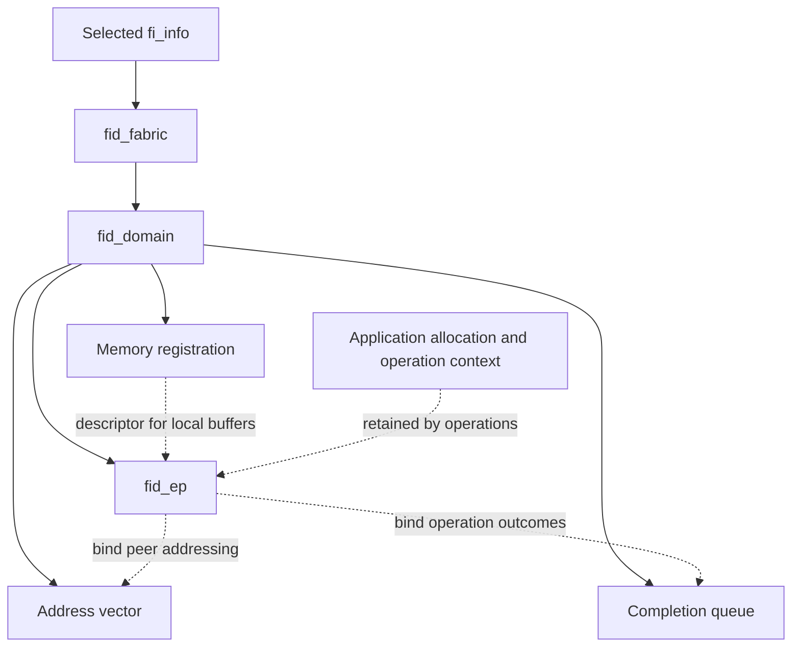
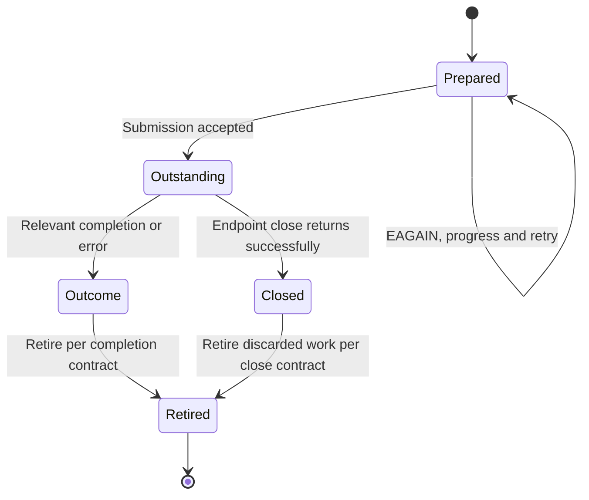

import Source from '../../../../components/Source.astro';

## Resource scopes explain setup and cleanup

libfabric separates fabric, domain, endpoint, addressing, completion and
registration because they have different scopes and sharing rules. Understanding
those relationships lets a caller create the right resources and unwind them
safely when startup or an operation fails.

The application owns resource construction. The provider implements each object
and validates its associations. An endpoint is an operation interface; application
allocations and request records retain their own ownership.

## Creation and binding are different relationships

Solid edges below the fabric show resource scopes; dotted edges show use or
binding. An endpoint can use a CQ or registration shared with other endpoints
where the selected contract permits it. Closing one endpoint therefore does not
automatically release every resource it used.

Startup follows a small sequence: choose `fi_info`, open fabric/domain resources,
create the endpoint and supporting objects, bind required resources, then enable
the endpoint for data operations. A created endpoint and an enabled endpoint are
different readiness states.

## An operation adds another lifetime

The caller retains its payload, registration references and operation context
while accepted work remains outstanding. A useful application bookkeeping model
is:

The state names describe application requests rather than a provider enum.
Acceptance begins asynchronous lifetime. The relevant completion contract or
completed endpoint close supplies the local retirement boundary.

Endpoint close discards outstanding work and can return without normal completion
entries for those operations. It can establish a documented local buffer-safety
boundary while leaving the distributed operation unsuccessful. Peer shutdown or
failure reporting still belongs to the surrounding application protocol.

## Decisions that affect ownership

**Sharing:** track every live user of domain-level CQ, AV and MR resources. Release
dependent objects before their parents, and preserve the original error during a
partial-startup unwind.

**Concurrency:** the returned threading and progress attributes define how callers
may submit and poll. Adding a progress thread changes the concurrency design and
must respect that contract.

**Shutdown:** finish or discard accepted work through the endpoint's documented
lifecycle before releasing its buffers. Then release shared resources after their
remaining users are gone.

These three choices explain most resource-lifetime questions without requiring a
catalog of every close method. For EFA, continue into the selected variant's
creation and teardown implementation once these ownership scopes are clear.

## Read the code

<Source project="libfabric" path="man/fi_domain.3.md" label="Domain scope, threading and progress" />
<Source project="libfabric" path="man/fi_endpoint.3.md" label="Bind, enable and close contracts" />
<Source project="libfabric" path="include/rdma/fabric.h" label="Generic fi_close dispatch" />
<Source project="libfabric" path="prov/efa/src/efa_base_ep.c" label="EFA endpoint resource implementation" />
