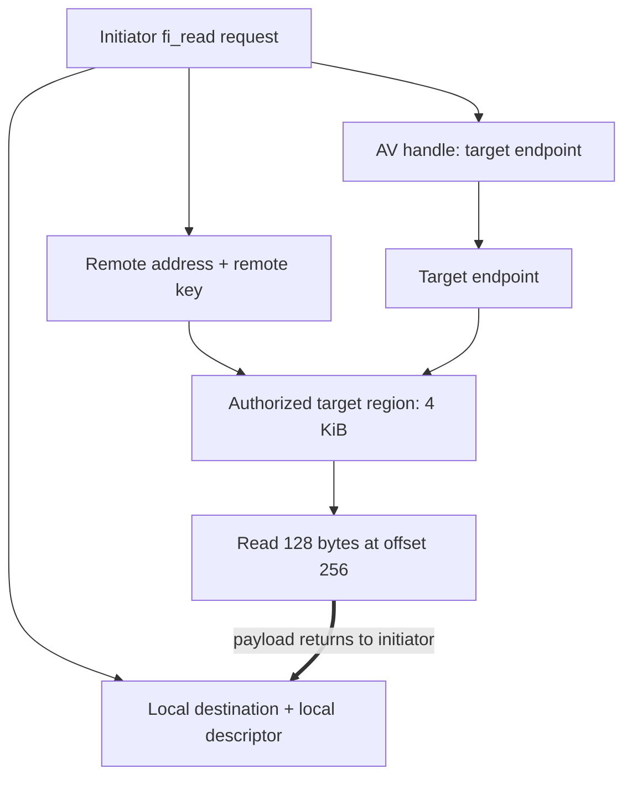

import Source from '../../../../components/Source.astro';

## Access remote memory through an explicit contract

**Remote memory access (RMA)** reads or writes a registered range at a peer without
requiring a matching receive for that payload. **Atomics** perform supported
updates at the target. Both require the application to establish addressing,
authorization and lifetime before issuing work.

The useful mental model is a network operation against an authorized range,
rather than an arbitrary pointer dereference in another process.

## Follow the identities in a read

The initiator's request combines four values:

| Value | What it identifies |
| --- | --- |
| AV handle | Target endpoint |
| Remote address | Target range under the negotiated addressing model |
| Remote key | Authorization associated with the target registration |
| Local descriptor | Initiator memory access information where required |

The operation context separately identifies the initiator's request at completion.
The target keeps its registration and allocation valid while peers may access it.

For the teaching example, read 128 bytes starting 256 bytes into a registered
4 KiB target region. FI_MR_VIRT_ADDR uses the target virtual address plus 256;
a zero-based model uses the corresponding offset. The selected MR mode determines
which interpretation the initiator must supply.

## Build the surrounding publication protocol

An RMA completion supplies the selected operation guarantee. Applications still
need to coordinate when a remote consumer may use a payload and when the target
can recycle or withdraw its memory.

A producer that writes bytes and then publishes a ready flag must establish the
ordering between those steps. The provider's supported ordering/fence rules and
the consumer's execution dependencies determine that edge. Placing two calls next
to each other in source is not the entire distributed synchronization protocol.

Likewise, releasing one initiator request does not establish that every other
peer has stopped using the same registration. Key exchange and withdrawal belong
to the application's shared-resource lifecycle.

## Decisions that change the implementation

**Required operation:** select FI_RMA or FI_ATOMIC services supported by the
endpoint. For atomics, validate the exact operation, datatype and supported count
with the corresponding validity query.

**Addressing and access:** use the returned MR rules and permissions when forming
the remote range and key. Keep local descriptors local.

**Provider mechanism:** EFA's protocol-based and direct paths expose different
services and device limits. A portable RMA call can reach provider protocol work
instead of one identical native device operation on every configuration.

## Read the code

<Source project="libfabric" path="man/fi_rma.3.md" label="Portable RMA operation and ordering contract" />
<Source project="libfabric" path="include/rdma/fi_rma.h" label="Read/write dispatch and argument roles" />
<Source project="libfabric" path="include/rdma/fi_atomic.h" label="Atomic validity queries" />
<Source project="libfabric" path="man/fi_efa.7.md" label="EFA-specific services and restrictions" />
