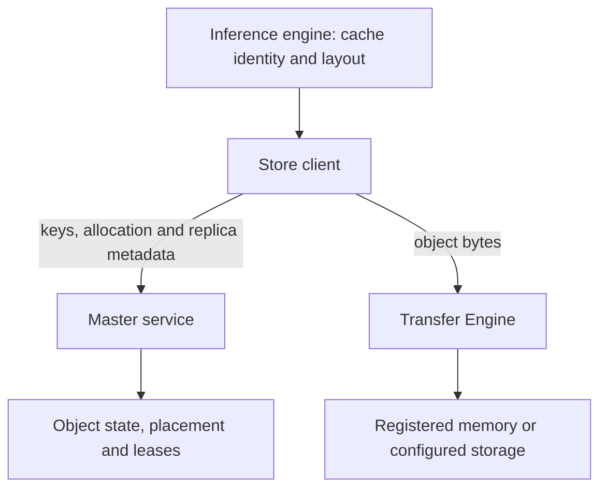

import SystemMap from '../../../components/SystemMap.astro';
import Source from '../../../components/Source.astro';

## Why it exists

Repeated prompt prefixes can make different inference workers recompute the same
attention state. Mooncake provides building blocks for sharing reusable data,
including **KV cache**, the attention state produced from input tokens.

Two layers solve different parts of that problem. **Transfer Engine** moves
registered byte ranges between known locations. **Store** adds named objects,
replica placement and discovery. A serving integration supplies cache identity,
layout and the decision about whether loading state saves useful computation.

## Where it fits

<SystemMap current="mooncake" />

Use Transfer Engine directly when the application already knows the peers and
ranges. Use Store when clients need to find an object without knowing where its
bytes currently reside. The Store master coordinates metadata; clients move
payload through the selected data path.

An engine connector is an optional integration. For example, vLLM can use a
separately configured Mooncake Store connector. Ordinary vLLM serving does not
require Mooncake. NIXL overlaps with the transfer responsibility, while Store adds
object and capacity management above byte movement.

## Architecture overview

The engine owns cache meaning. The Store client coordinates object operations.
The master owns replica metadata, placement and leases. Transfer Engine and
configured storage paths perform the byte movement. A **replica** is one stored
copy; a **lease** protects access for a bounded interval under Store's rules.

This separation is the main source-reading map: object lookup and publication
belong to Store, while registration, submission and transfer completion belong
to the data path.

## Follow an operation

For a memory-backed cache object:

1. The integration chooses a compatible key and representation. A write asks the
   master for replica allocations, transfers payload, then publishes successful
   replicas through Store finalization.
2. A reader queries the key and receives usable replica descriptors and a lease.
3. The client selects a copy and transfers it into caller-owned destination slices.
4. Store validates the read, including applicable integrity and lease checks.
5. The integration installs the state into the engine's layout and establishes
   the execution dependency before GPU consumption.

Allocation, payload completion and a validated cache hit are separate milestones.
That distinction explains both the normal path and most failure investigations.

## Decision gates

| Choice | Effect on the architecture |
| --- | --- |
| Direct transfer or Store | Determines whether the application owns placement and object discovery. |
| Replica and tier policy | Trades capacity, transfer traffic and availability. |
| Transport and topology | Determine how registered ranges are reached efficiently. |
| Integration fallback | Determines what the engine does when state is absent or unusable. |

Start with the [repository map](/architecture/mooncake/repository-map/), then follow
[startup](/architecture/mooncake/startup/) and either the transfer or Store path.

## Explore the code

<Source project="mooncake" path="mooncake-store/include/client_service.h" label="Store client interface" />
<Source project="mooncake" path="mooncake-store/src/client_service.cpp" label="Query, Get and Put coordination" />
<Source project="mooncake" path="mooncake-store/src/master_service.cpp" label="Metadata and replica lifecycle" />
<Source project="mooncake" path="mooncake-transfer-engine/include/transfer_engine.h" label="Transfer Engine lifecycle" />
