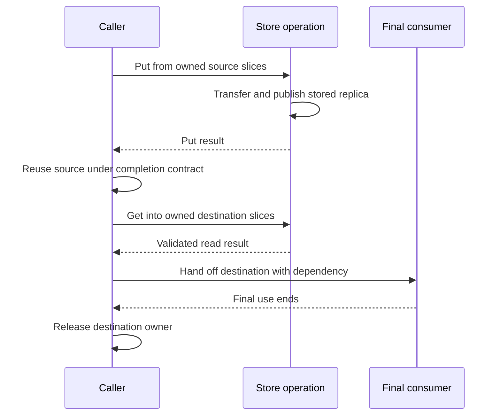

import Source from '../../../../components/Source.astro';

## Distinguish stored objects from caller buffers

A Store object can outlive the source buffer used to write it. A destination can
remain in use after Get returns. Transfer operations can also retain memory beyond
a caller's timed wait. These are different lifetimes, with different owners.

The application owns its source and destination. Contributed segments supply the
stored replicas. The master coordinates replica lifecycle, and Transfer Engine
retains the state needed to finish data-path work.

## Follow a new object through Put and Get

The stored replica has its own owner between the two calls. Passing slices gives
an operation access to memory; the slice list itself need not own that memory.

## Use the owning abstraction

`ClientBufferAllocator` suballocates a pool and returns move-only `BufferHandle`
values. An owning handle retains allocator/range ownership. A view can instead
carry a pointer, length and release callback. Read the wrapper's ownership contract
before assuming that copying a pointer or slice extends allocation lifetime.

Three pools can coexist in one process:

| Pool | Responsibility |
| --- | --- |
| Contributed segment | Supplies stored replica capacity. |
| Client buffer pool | Supplies local request sources and destinations. |
| Host staging pool | Supports transfers between devices or storage paths. |

They can have different registration and reuse rules even when managed by one
service.

## Identify the actual reuse boundary

The synchronous client transfer helpers wait for their submitted transfer result.
At the raw Transfer Engine boundary, the caller must instead observe the selected
completion and cleanup contract. A timeout or retired batch handle alone does not
establish that referenced storage is unused.

After a successful read, the final CPU or GPU consumer can extend destination
lifetime. Keep an owning reference until that use ends and establish the required
execution ordering before handing data to an accelerator.

Pinned host memory is an access capability to request deliberately. The ordinary
pool acquisition path can fall back to pageable memory, while explicit pinned-only
allocation has a stricter contract. Check the API used when a transfer path
requires pinned storage.

## Read the code

Read `ClientBufferAllocator` and `BufferHandle`, then follow the client transfer wait and final consumer ownership.

<Source project="mooncake" path="mooncake-store/include/client_buffer.h" label="Owning handles and slice views" />
<Source project="mooncake" path="mooncake-store/src/client_service.cpp" label="Client transfer wait and validation boundaries" />
<Source project="mooncake" path="mooncake-store/include/pinned_buffer_pool.h" label="Host staging allocation contracts" />
