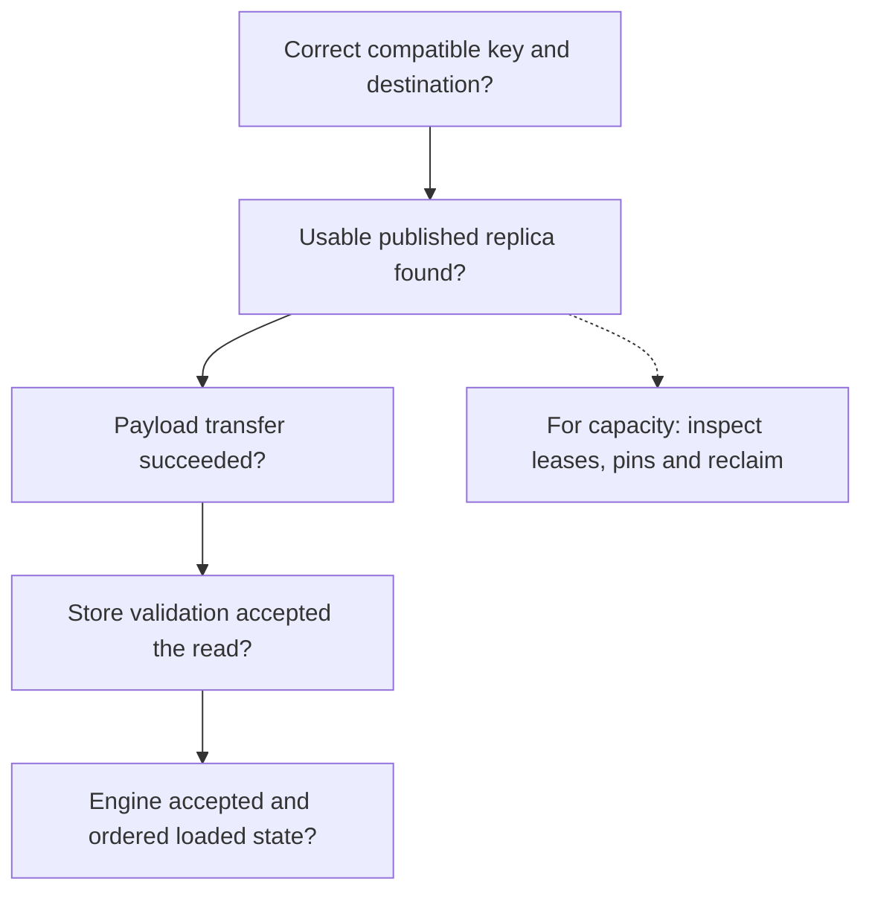

import Source from '../../../../components/Source.astro';

## Start at the first missing guarantee

A cache miss, failed transfer and delayed reclaim can look similar from an engine
waiting for usable KV. Diagnose the first boundary without evidence of success:
object compatibility, publication, transfer, validation or consumer readiness.
That identifies which owner and source path to inspect.

The questions form a source-reading order. They are not a single universal retry
algorithm; the integration owns its miss and failure policy.

## Trace one key through metadata and bytes

First record the key namespace and expected model/layout. Then inspect the master's
replica state. Allocated processing replicas are different from usable published
copies. A placement request can also obtain fewer allocations than requested,
which the write policy must interpret before reporting success.

For an accepted read, retain replica identity, destination ranges, transfer outcome
and the Store result. Bytes can arrive while validation still rejects the read,
for example after lease expiry or an integrity failure. Continue into the engine
only after the Store result and compatibility requirements are satisfied.

This sequence distinguishes failures of object meaning from failures of data
movement. It also explains why increasing network concurrency cannot repair a
wrong key or unfinished publication.

## Follow the owner when memory stays retained

A read lease or hard pin can legitimately prevent eviction. An offload can retain
its source while a new copy is in flight. A suspected resource owner can stop
serving new work while retaining resources during the liveness grace period.

Inspect those owners before interpreting every retained byte as a leak. Compare
actual released memory, queued offload work and remaining usable replicas. Those
measure different lifecycle stages.

Recovery adds the same distinction at a larger scale: restored metadata still
needs valid mounts and surviving payloads. Readability, durable log progress and
physical storage survival are separate facts.

## Keep the diagnostic record small and useful

For one operation, capture selected engine/transport, compatible key, replica and
lease metadata, source/destination ownership, submission/completion result and
current consumer state. For capacity, add the owner retaining the allocation and
the reclaim action awaiting completion.

Use metrics to locate that stage, then follow its source. Store traffic counts
can explain movement; the inference engine measures actual computation saved.

## Read the code

<Source project="mooncake" path="mooncake-store/src/client_service.cpp" label="Put/Get coordination and returned outcomes" />
<Source project="mooncake" path="mooncake-store/src/master_service.cpp" label="Publication, lookup and metadata ownership" />
<Source project="mooncake" path="mooncake-store/src/eviction/offloading_reclaimer.cpp" label="Retained offload sources" />
<Source project="mooncake" path="mooncake-store/include/client_liveness.h" label="Resource-owner liveness" />
