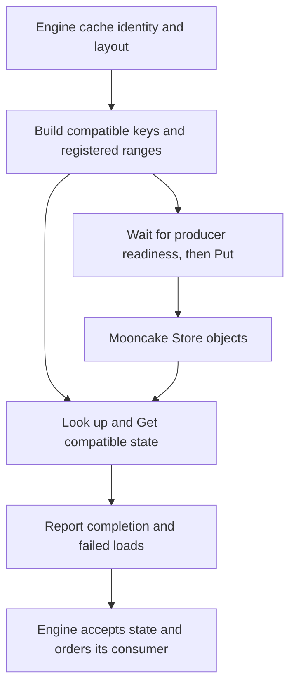

import Source from '../../../../components/Source.astro';

## The engine supplies cache meaning

Store handles named byte objects. An inference engine knows which tokens produced
KV state, which model/layout produced it, which parallel rank owns each shard,
and when GPU computation may use it. A connector translates that meaning into
keys, buffer descriptors and asynchronous Store operations.

The optional pinned vLLM Store connector provides a concrete example. It is one
configured integration, rather than a prerequisite of ordinary engine serving or
an automatic feature of every Store call.

## Follow save and load through the connector

The graph separates semantic compatibility from data movement. A completed
transfer becomes useful reuse only when the engine can accept and consume the
loaded state.

## Translate logical cache into physical ranges

A token-prefix hash identifies content within a namespace. The connector also
includes relevant model, parallel-rank and layout identity so a key cannot select
incompatible KV bytes merely because token IDs match.

Its layout abstraction maps logical chunks to the local engine's physical blocks,
layers and tensor regions. Registered ranges follow the actual representation,
including meaningful strides and padding. The Store receives those byte ranges;
it does not reconstruct the engine's scheduling or block-table abstraction.

This is the first source boundary to inspect when a lookup succeeds but loaded
state is unusable: compare the key namespace, expected shards and physical ranges
on the producer and consumer.

## Keep execution and allocation lifetimes explicit

On save, the vLLM worker records a CUDA event after the producing forward work.
The sending thread waits for that event before issuing the relevant Store writes.
This establishes the dependency from KV production to network access.

Loads report failures as well as finished work. The surrounding engine decides
which state it may accept and how to recover missing or failed ranges. Request
completion alone cannot turn a failed load into valid cached state.

Registered allocations must also remain live through transfers. During model
sleep or allocator remapping, the integration drains communication and renews
registration appropriately; an unchanged virtual address does not revive access
state for different backing memory.

## Decisions and source route

Trace layout/key construction → `start_load_kv` or `wait_for_save` → worker threads → `get_finished` → engine acceptance.

**Compatibility:** choose key namespaces and layout/shard mapping together.

**Reuse policy:** compare lookup/load cost with computation avoided; traffic alone
is not a measure of useful reuse.

**Scheduling handoff:** connect producer, transfer, accepted result and final GPU
consumer dependencies through their owning layers.

<Source project="vllm" path="vllm/distributed/kv_transfer/kv_connector/v1/mooncake/store/worker.py" label="Optional Store connector ownership and event fences" />
<Source project="vllm" path="vllm/distributed/kv_transfer/kv_connector/v1/mooncake/store/layout.py" label="Cache keys and physical range mapping" />
<Source project="mooncake" path="mooncake-integration/store/store_py.cpp" label="Python Store boundary" />
