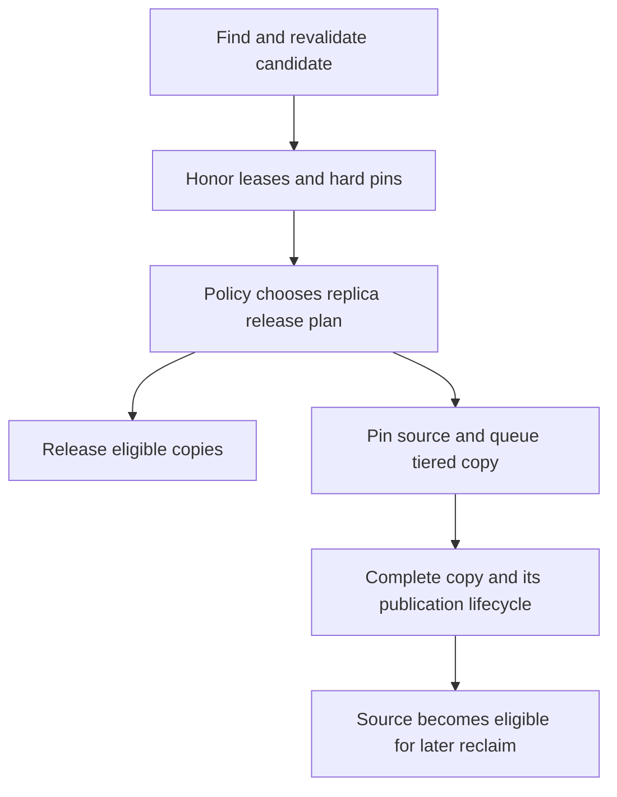

import Source from '../../../../components/Source.astro';

## Reclaim capacity without losing the ownership model

Store capacity is finite. **Eviction** selects eligible replicas to release;
**tiering** can first move reusable data to a different storage medium. Both act
through the object's lifecycle, where leases, pins and in-flight transfers can
retain storage.

A capacity manager therefore measures actual released memory, not merely objects
examined or bytes queued for offload.

## Follow a reclaim decision

The diagram shows ownership and policy stages. Queue acceptance starts work;
it does not immediately free the protected source.

## Separate candidate ordering from authority

The eviction index helps find candidates cheaply. The evictor rechecks current
object identity and protection before acting, because reads can extend a lease
and objects can be replaced after an index entry was recorded.

Hard pinning and active read leases constrain reclaim before policy chooses a
plan. A soft pin instead participates in policy and fallback. Grouped objects
can share lifecycle scope, so decisions may apply to a related set rather than
one independent key.

The plan names replicas. Releasing one copy can reclaim capacity while leaving
an object available elsewhere; removing the last usable copy has a different
customer consequence.

## Offload retains enough data to finish

The offloading reclaimer wraps ordinary release. It preserves a source reference
for an accepted copy, removes that source from immediate release, and can release
other eligible memory copies. After the target copy completes and the lifecycle
permits it, a later reclaim can release the preserved source.

For example, two memory replicas can become one pinned offload source plus one
released replica. One object's worth of data may be queued while only one copy's
memory was reclaimed. This explains retained memory during healthy background
movement without needing to inspect every queue branch.

## Choose the capacity and failure policy

**Preserve or recompute:** tiering can retain future reuse at the cost of storage
and transfer work. A configured drop policy can instead trade reuse for immediate
capacity.

**Goals and scope:** reclaim operates under configured targets and namespace scope.
Pinned or leased objects can limit the amount immediately available.

**Storage readiness:** a queued or unusable storage descriptor is insufficient to
replace a live source. Track complete usable copies and actual released bytes
separately when diagnosing a capacity shortfall.

## Read the code

Follow the evictor candidate walk into the selected release plan and `OffloadingReclaimer::Apply`.

<Source project="mooncake" path="mooncake-store/include/eviction/policy.h" label="Policy and protection boundaries" />
<Source project="mooncake" path="mooncake-store/src/eviction/evictor.cpp" label="Candidate revalidation and release planning" />
<Source project="mooncake" path="mooncake-store/src/eviction/offloading_reclaimer.cpp" label="Source retention and tiered reclaim" />
