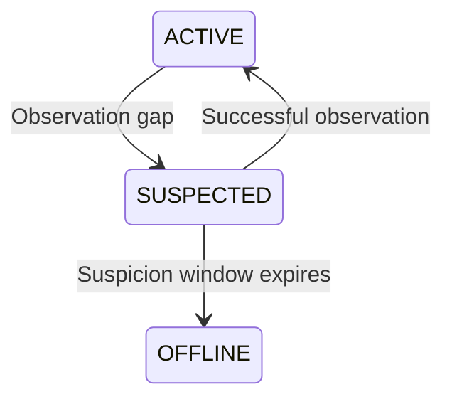

import Source from '../../../../components/Source.astro';

## Protect reads and retire failed owners

A **read lease** protects an object while an authorized reader accesses it.
**Client liveness** tracks whether a Store resource owner is still eligible to
serve and retain its contributed state. These mechanisms protect different
relationships and advance on different events.

The master uses both when deciding whether storage is available or reclaimable.
A heartbeat observation does not publish object bytes, and a read lease does not
establish that an unreachable owner is healthy.

## Follow the owner state model

`IsServing` accepts ACTIVE. `ShouldRetainResources` continues through SUSPECTED.
That interval prevents a brief loss of observations from immediately reclaiming
resources that may still be referenced. OFFLINE is terminal for that client
incarnation; recovery requires the appropriate new registration lifecycle.

## Read protection follows the object

Lookup grants a bounded read lease. A normal extension preserves the latest
existing deadline rather than shortening another reader's protection. Eviction
checks the current lease before reclaiming the object.

Grouped objects can share a lease and an all-or-none eviction scope. Reading one
member can therefore extend protection for the group, while each object keeps
its own key and payload identity.

The reader separately tracks the local expiry associated with its query result.
The Store read validates that lease after transfer. Long transfer time can turn a
completed byte copy into a failed logical read, so the integration consumes only
validated success.

## Retirement is an owned transition

Liveness guards coordinate operations with terminal offlining. The transition
reserves cleanup responsibility before exposing the owner as terminal, then the
owner's cleanup path retires metadata and contributed resources.

This is the useful concurrency boundary for tracing: an operation needs current
authority to use retained state, not merely an earlier casual health check.
The exact locks and monitor timing implement that boundary and can be read when
changing liveness behavior.

## Decisions and source route

**Lease duration:** trades time for reads against how long capacity remains
protected from reclamation.

**Suspicion policy:** balances transient observation gaps against timely retirement
of unavailable owners. Monitor scheduling and the two stages influence observed
cleanup latency.

**Grouping:** links lifecycle protection for related objects, which can simplify
consistent reuse while retaining more capacity together.

<Source project="mooncake" path="mooncake-store/include/lease.h" label="Read protection and monotonic extension" />
<Source project="mooncake" path="mooncake-store/include/client_liveness.h" label="Serving, retention and terminal transitions" />
<Source project="mooncake" path="mooncake-store/src/client_offboarding.cpp" label="Owner resource retirement" />
