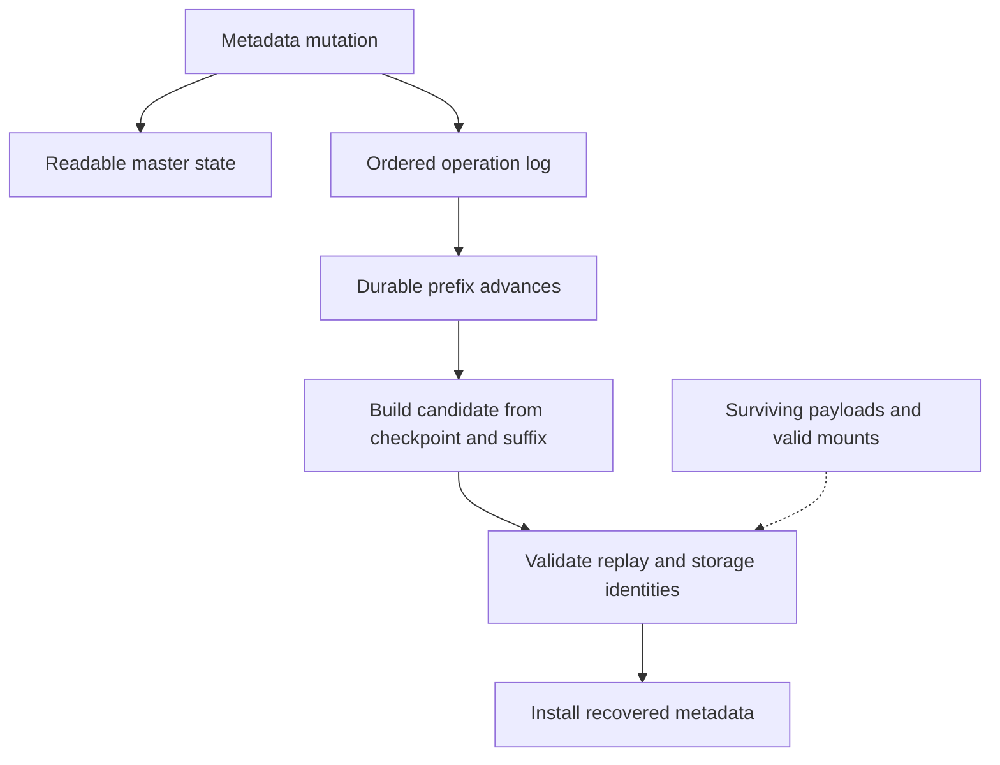

import Source from '../../../../components/Source.astro';

## Recover knowledge of surviving storage

Metadata recovery rebuilds the master's knowledge of objects, replicas and
segments. A recovered object is useful only when its descriptor still identifies
valid storage or a surviving persistent copy. Recovery of a record and survival
of its payload are separate requirements.

High availability and metadata persistence are configured extensions. First
identify the active logging and recovery path, then follow how it prepares and
installs trustworthy state.

## Trace logging through recovery

The ordinary PutEnd path uses visible-before-durable logging. A readable object
therefore does not, by itself, imply that its metadata transition has reached
persistent storage. The selected durability contract determines what failure
protection the caller can rely on.

## Build a candidate before replacing active state

The ordered log supplies mutation sequence. A snapshot captures a checkpoint,
while later log entries supply the suffix needed to catch up. Recovery needs
both valid checkpoint artifacts and replay coverage through the chosen durable
position.

The implementation prepares a candidate independently of the installed standby
state. It validates the snapshot and replay, checks segment/address identities,
and installs only a usable candidate. Keeping preparation separate from activation
preserves the existing state when a replacement cannot be validated.

Some runtime policy is renewed rather than serialized as permanent authority.
For example, restored metadata omits ordinary read-lease state and the promoted
primary grants fresh leases. A recovered pointer-like descriptor still needs the
appropriate live mount/incarnation relationship.

## Decisions that define protection

**Metadata persistence:** choose the configured HA/backend contract before
interpreting a successful metadata mutation as durable.

**Payload placement:** volatile memory and persistent storage have different
survival properties. More replicas and storage tiers protect against different
failures and add their own costs.

**Recovery activation:** verify the checkpoint, contiguous replay suffix and
current storage identities before replacing installed metadata. A parsed artifact
alone is insufficient authority to serve its described bytes.

These boundaries explain the architecture without following every manifest,
cleanup or maintenance-token branch. Enter those details when changing the
recovery implementation or investigating a rejected candidate.

## Read the code

Start at `MasterService::PutEnd`, then follow ordered logging, checkpoint construction and standby candidate installation.

<Source project="mooncake" path="mooncake-store/src/master_service.cpp" label="Persistence configuration and visible metadata mutations" />
<Source project="mooncake" path="mooncake-store/include/ha/oplog/ordered_oplog_writer.h" label="Ordered logging and durability boundary" />
<Source project="mooncake" path="mooncake-store/src/ha/snapshot/batch_oplog/writer.cpp" label="Checkpoint construction" />
<Source project="mooncake" path="mooncake-store/src/hot_standby_service.cpp" label="Candidate recovery and installation" />
