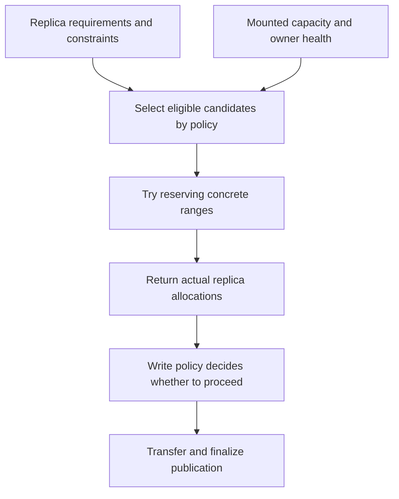

import Source from '../../../../components/Source.astro';

## Choose a home, then reserve a range

A Store write requests replicas, but the master must turn that request into
concrete storage. **Placement** chooses eligible capacity according to policy.
**Allocation** reserves a range from the chosen capacity. A preferred host can be
reachable yet lack a suitable allocatable range.

This boundary connects operator intent to the actual descriptors the writer will
use. Track requested replicas and returned allocations separately.

## Follow one allocation request

Placement describes where to try. Allocation proves which reservations were
obtained. The general allocator can return a nonempty best-effort result, so a
vector of descriptors is not automatically proof that every requested copy exists.

## Read the request at the right level

Replica requirements describe how many copies and which media are desired.
Constraints and preferences describe eligible or preferred placements. Host
identity and locality influence where those copies should live.

The allocator collects candidates, applies the configured policy, and tries
reservations. Preferences can fall back to other eligible capacity. Exclusions,
owner health and available allocatable ranges still constrain that search.

For example, a request for three replicas can obtain two after a preferred
candidate cannot allocate. The write path must interpret those two under its
selected policy rather than silently treating the request as fully satisfied.
That is the useful architecture lesson; individual candidate iteration details
remain in the allocator.

## Decisions that affect the result

**Replica policy:** additional copies consume capacity and transfer work in
exchange for availability or locality. The caller and finalization policy determine
what result is acceptable.

**Locality policy:** a placement host ID expresses affinity, while a transfer
endpoint supplies network reachability. Keep them separate when tracing why a
copy was chosen and how it is reached. Local NUMA or device identifiers also have
meaning within their owning host.

**Effective capacity:** aggregate free bytes do not guarantee a suitable range.
Fragmentation, exclusions and registration state can reduce usable capacity.
Inspect the actual candidate/allocation outcome before increasing replica count
or changing placement preferences.

Reservations stay associated with replica metadata and their owning allocator.
The writer receives access descriptors; revocation and reclamation release the
underlying reservations through Store's lifecycle.

## Read the code

Start with the allocation request types, then follow `AllocateWithRanker` into the chosen candidate allocator.

<Source project="mooncake" path="mooncake-store/include/placement/replica_allocator.h" label="Allocation requirements and result contract" />
<Source project="mooncake" path="mooncake-store/src/placement/replica_allocator.cpp" label="Candidate selection and range reservation" />
<Source project="mooncake" path="mooncake-store/include/placement/candidate.h" label="Capacity candidate boundary" />
