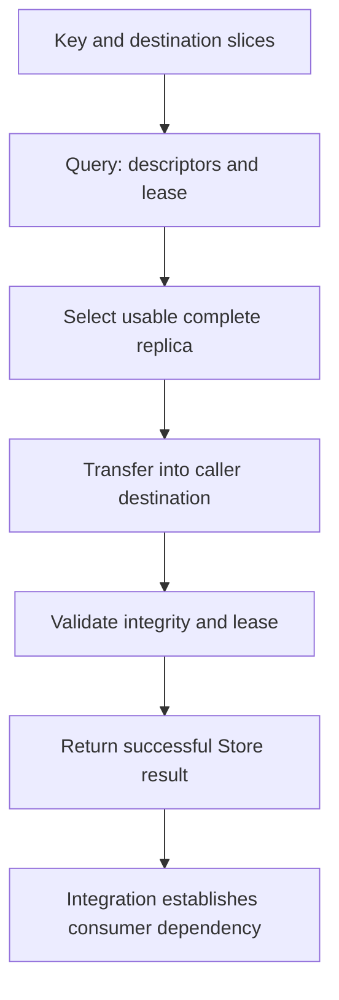

import Source from '../../../../components/Source.astro';

## A read combines discovery, copying and validation

Store Get begins with an object key and caller-owned destination slices. The
client needs a usable replica, a supported data path, and enough time under the
returned lease to complete the read. These are separate parts of the contract.

A metadata query locates the object; it does not return the payload. A successful
byte copy is followed by Store validation before the integration can use the
result as a cache hit.

## Follow the ordinary Get path

The graph shows the successful path. A failed lookup, transfer or validation
returns a failure for the caller's fallback policy to handle.

## Trace the buffers and protection

`Query` asks the master for a replica list and constructs a result containing
access descriptors, integrity information and expiry. The lease bounds how long
that metadata can authorize access; lookup time is part of the read's time budget.

The client chooses a complete replica suitable for its destination and configured
backends. A memory path delegates byte movement to Transfer Engine; configured
storage paths supply their own read implementation. A local hot-cache reference
also stays retained through its transfer use.

The stored source belongs to its contributor/replica lifecycle. The destination
belongs to the caller. Get must validate destination capacity and operate on the
logical object length, even when the supplied buffer is larger.

## Understand the validation boundary

After a successful transfer, the client verifies the logical object's checksum
where enabled and checks the query result's lease. A copy that finishes after its
lease expires can leave bytes in the destination while returning a failed read.
The caller must use the returned Store result, rather than treating changed
memory as evidence of a valid cache load.

Transport failures remain failures; enabling integrity checks or extending a lease
does not repair a broken data path. Conversely, a healthy network does not make
incompatible cache identities or stale metadata safe.

## Decisions and source route

**Replica choice:** locality, medium and destination compatibility determine which
usable copy the client can read.

**Miss/failure policy:** the serving integration chooses recomputation, another
lookup or an error according to its own contract. Store does not schedule tokens.

**Consumer handoff:** after success, the integration maps bytes into engine state
and establishes CPU/GPU ordering before use.

<Source project="mooncake" path="mooncake-store/src/client_service.cpp" label="Client::Query, Get and read validation" />
<Source project="mooncake" path="mooncake-store/src/master_service.cpp" label="Replica lookup and read protection" />
<Source project="mooncake" path="mooncake-store/include/client_service.h" label="Query result and destination contract" />
