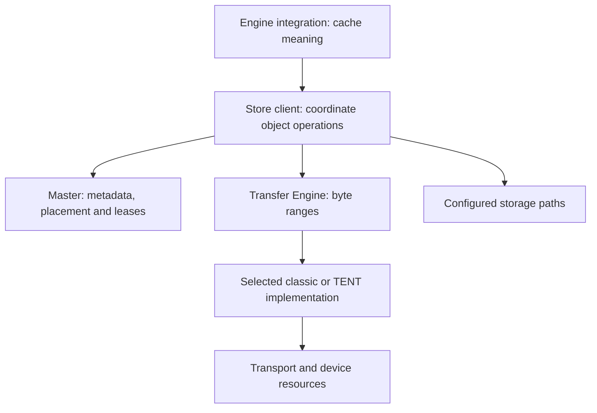

import Source from '../../../../components/Source.astro';

## Start with the responsibility you need

Mooncake serves two related customers. A communication caller needs bytes moved
between known ranges. A shared-cache caller needs to find and reuse an object
without embedding its current placement in every request. Transfer Engine supplies
the first contract; Store builds the second over data movement and metadata.

An inference engine adds another responsibility: deciding which token state is
compatible, useful and safe to consume. Keep those three layers visible before
opening individual implementation files.

## The main owners in the tree

The arrows represent API/data-path relationships. The master coordinates object
records while the client moves the payload; object bytes do not need to pass
through the master.

| Area | Main question |
| --- | --- |
| `mooncake-store` client | How does an object operation combine metadata and transfer? |
| `mooncake-store` master | Which replicas exist, are readable, and may be reclaimed? |
| `mooncake-transfer-engine` | How are memory ranges registered, submitted and completed? |
| Bindings and integrations | How do application keys, buffers and execution dependencies cross the API? |

## Trace one object across the boundaries

A writer supplies a key and source slices. The client requests placement, transfers
into allocated replicas, and finalizes publication. A reader later obtains replica
metadata, copies from a usable location, and validates the result. Its destination
belongs to the reader, while the contributed segment supplies the stored copy.

This path gives an efficient reading order: client API → client operation → master
metadata call → selected transfer implementation. Enter a transport only when the
question concerns how bytes move. Enter an integration when the question concerns
what those bytes mean to a model.

## Choices that change the route

**Transfer-only or Store:** direct callers can bypass object metadata when their
own framework already owns discovery and lifetime policy.

**Classic or TENT:** the public transfer facade can select different implementations.
Follow the configured path before interpreting internal handles or topology hints.
The classic batch representation is not a universal description of native TENT.

**Storage and integration:** optional disk/storage backends and serving connectors
add their own setup and ownership. Introduce them where the selected operation
uses them, rather than making them prerequisites of every transfer.

## Read the code

Start with `Client::Put` or `Client::Get`, then follow the master call and selected transfer facade.

<Source project="mooncake" path="README.md" label="Repository scope" />
<Source project="mooncake" path="mooncake-store/include/client_service.h" label="Client operation boundary" />
<Source project="mooncake" path="mooncake-store/include/master_service.h" label="Master metadata boundary" />
<Source project="mooncake" path="mooncake-transfer-engine/src/transfer_engine.cpp" label="Transfer facade and implementation selection" />
