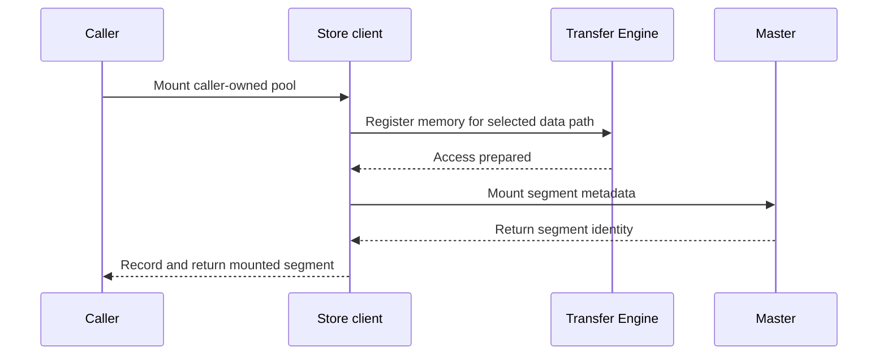

import Source from '../../../../components/Source.astro';

## Establish metadata, data-path and capacity readiness

A memory-backed Store deployment needs a master accepting metadata operations,
clients with working transfer paths, and mounted segments that supply object
capacity. These are separate readiness milestones. Connecting an RPC client alone
does not contribute storage or establish payload access.

Start with this simple deployment before adding optional storage, high availability
or accelerator memory. Each extension has its own setup, while the core ownership
model stays the same.

## Follow the client's dependency chain

`Client::Create` connects to the master, obtains relevant configuration and enters
its runtime mode. An ordinary data client then initializes or reuses Transfer
Engine, prepares its submitter and arranges local caching. A metadata-only client
can support control operations without the ordinary transfer path.

Reusing a supplied Transfer Engine preserves the initialized engine's actual
metadata and network identity. That matters when the Store-facing hostname and
transfer endpoint are different values.

The next step is contributing memory. Mounting joins transfer access with Store
placement:

The successful route registers memory before advertising it for allocation. The
caller still owns the pool after the mount succeeds.

## Know which identity serves which purpose

A mounted segment records its range, identity, protocol and transfer endpoint.
Placement can also use a host identity or locality affinity to choose capacity.
The placement host and routable endpoint answer different questions: where data
should preferably live, and how transfer work reaches it.

Keep those identities with readiness diagnostics. A reachable master, a registered
pool and usable allocated capacity describe different parts of startup.

## Decisions that affect startup and shutdown

**Contribute capacity or only consume it:** a client can read/write objects without
assuming every process must contribute an identical pool.

**Configure storage explicitly:** optional storage adds initialization requirements
once selected. Check readiness for the operations the application intends to use.

**Retire capacity before access:** unmount removes Store authority to allocate and
use the contribution before transfer registration is withdrawn. Preserve the
backing allocation while outstanding work can still reference it. Partial setup
failures require unwinding the resources actually acquired.

## Read the code

Read `Client::Create` → `MountSegmentAndGetId` → `UnmountSegmentImpl` to connect setup with teardown.

<Source project="mooncake" path="mooncake-store/src/master.cpp" label="Master configuration and startup" />
<Source project="mooncake" path="mooncake-store/src/client_service.cpp" label="Client::Create, mount and unmount" />
<Source project="mooncake" path="mooncake-store/include/client_service.h" label="Client setup inputs and ownership" />
