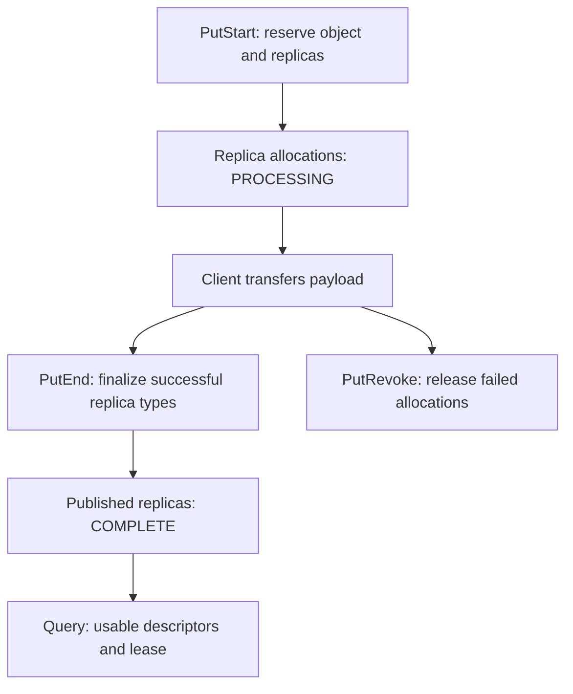

import Source from '../../../../components/Source.astro';

## Metadata determines which bytes are readable

The Store master tracks object identity, writer authority, replica descriptors,
read protection and lifecycle policy. Those records turn allocated byte ranges
into discoverable objects. Transfer Engine can finish copying bytes while the
corresponding replica is still unpublished.

For a new developer, the central distinction is **allocated**, **filled**, and
**published**. The write path connects these states; the read path consumes only
usable replicas under a valid access contract.

## Follow the publication path

The graph shows the ordinary object lifecycle. An object can have multiple copies
whose publication histories differ; one complete memory replica can be readable
while another allocated copy is still pending or being revoked.

## Keep identity and authority together

Tenant and key identify the object. Its metadata retains the initiating writer
and the replica state needed to finalize the right write. The master coordinates
updates through its key accessors so allocation and stale-state cleanup do not
leave an unprotected gap for another writer.

Replica descriptors identify storage locations and media. They give a client the
information needed to reach a copy; receiving a descriptor does not transfer
ownership of that storage to the reader. The master and allocator continue to
coordinate its lifetime.

Group and session information serve different purposes. A group can connect
lifecycle policy across objects, while session fields attribute work. Neither
replaces the object's own key and incarnation.

## Three boundaries to retain

**Publication:** PutEnd changes replica availability in metadata after the write's
selected transfer/finalization policy succeeds.

**Read protection:** lookup returns usable replicas with a bounded lease. The
client must complete and validate the read under that contract.

**Persistence:** a readable replica and durable metadata are different guarantees.
Payload survival depends on its storage medium; metadata logging/recovery is
separately configured.

An object removed and recreated under the same key is also a new lifetime.
Deferred eviction or cleanup must still refer to the incarnation it observed,
not an unrelated allocation that later reused the key or address.

## Read the code

Follow `PutStart` → `PutEnd` or `PutRevoke` → replica lookup, tracking the same object and writer.

<Source project="mooncake" path="mooncake-store/include/object_metadata.h" label="Object identity and lifecycle metadata" />
<Source project="mooncake" path="mooncake-store/include/replica.h" label="Replica states and descriptors" />
<Source project="mooncake" path="mooncake-store/src/master_service.cpp" label="PutStart, PutEnd, revoke and lookup" />
