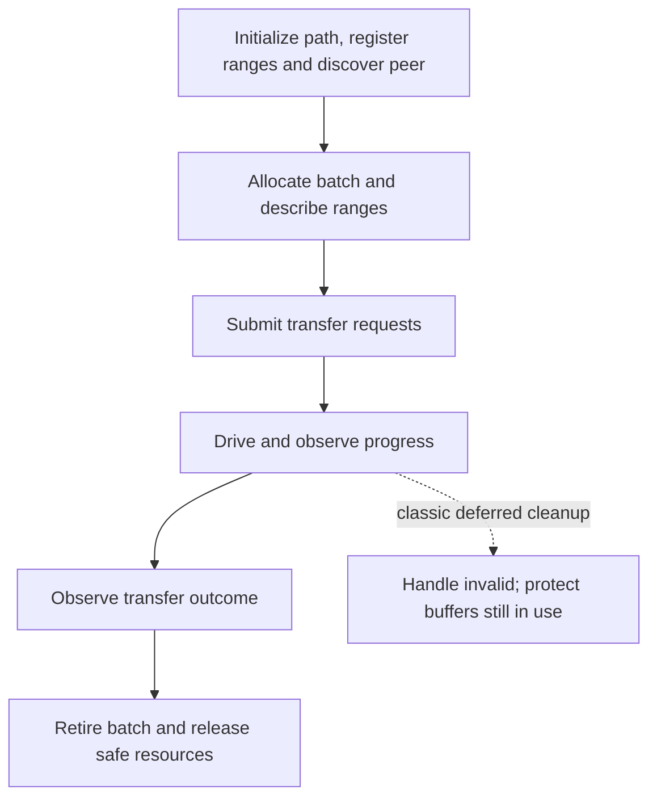

import Source from '../../../../components/Source.astro';

## Move byte ranges independently of object meaning

Transfer Engine accepts local memory, a remote segment/range, a length and an
operation. It arranges the selected transport and exposes completion state.
The caller decides what those bytes mean and when they may be published or used.

A **segment** describes remotely addressable storage. Registration establishes the
access needed by the chosen data path. A batch groups transfer requests and gives
the caller a handle for tracking their progress.

## Follow an ordinary batch

The solid path describes normal completion. The dotted branch marks an important
lifetime boundary rather than a second successful transfer path.

A WRITE reads the local buffer and writes the remote range. A READ fills the
local buffer from the remote range. The classic request field named `source`
therefore refers to the local destination for READ; interpret address roles using
the operation rather than the field name alone.

## Track work, buffers and handles separately

Submission success reports acceptance. Progress and status report the operation's
outcome. Multiple requests in a batch can complete differently, so the batch does
not create an atomic transaction across its ranges.

The caller retains memory while accepted work can reference it. Classic
`freeBatchID` can transfer a busy batch to deferred cleanup and invalidate the
public ID before the work has stopped accessing its buffers. That result is not
permission to poll the retired ID or immediately recycle the storage. Internal
cleanup also waits for completion callbacks to quiesce.

These semantics explain why Store adds publication above transfers: a completed
byte-range request alone cannot decide whether a multi-replica object is ready.

## Decisions that change the implementation

**Classic or TENT:** the facade can select alternative implementations. Follow
that selection before interpreting handles, registration or scheduling hints.
Classic pointer-backed batch details do not describe every native TENT object.

**Transport:** the configured path determines device access, registration and
progress costs. Choose and validate it before tuning locality preferences.

**Retry/publication:** the application owns object identity and consistency.
Retried work must still target the intended live storage, and final consumers
need their own execution dependency after successful transfer.

## Read the code

Read `openSegment` → `allocateBatchID` → `submitTransfer` → `getTransferStatus` → `freeBatchID`, with registration established for the selected path.

<Source project="mooncake" path="mooncake-transfer-engine/include/transfer_engine.h" label="Public registration, segment and batch lifecycle" />
<Source project="mooncake" path="mooncake-transfer-engine/include/transport/transport.h" label="Transfer request and outcome contract" />
<Source project="mooncake" path="mooncake-transfer-engine/src/transfer_engine.cpp" label="Implementation selection" />
<Source project="mooncake" path="mooncake-transfer-engine/src/multi_transport.cpp" label="Classic batch progress and deferred cleanup" />
