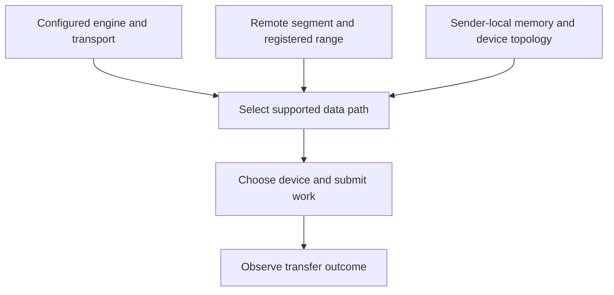

import Source from '../../../../components/Source.astro';

## Reachability and locality answer different questions

A working transfer path must reach the peer's registered memory. An efficient path
also benefits from choosing devices close to the relevant CPU or accelerator
memory. Mooncake's transport and topology layers connect those two concerns.

The transport supplies the access mechanism. Topology describes local relationships
among memory locations and network devices. A preference helps select a route;
it does not create missing device access or registration.

## Follow the selected data path

The arrows represent inputs to path selection. Receiver placement affinity and
sender device selection are related optimizations but have separate owners and
local identity spaces.

## Separate setup from optimization

Start by identifying the active classic or TENT implementation and the configured
transport. The public facade has compatibility entrypoints, so the name of an
installation method alone may not reveal the selected underlying mechanism.

Next establish segment discovery and valid registration for the actual memory
interface. Only then inspect topology preferences and the device used by a
particular operation. RDMA, TCP and other supported backends have different setup
and access requirements; one provider's discovery path does not describe them all.

A topology entry associates a memory location with preferred and fallback network
devices. It provides guidance within a host. NUMA IDs or accelerator ordinals from
different machines cannot be compared as though they described one shared topology.

## The decisions that matter

**Where to store:** Store placement can use receiver-side host or device affinity
to choose contributed capacity. This is a placement decision before the reader
selects its own transfer route.

**Which local path to use:** the sending side combines supported memory access
with its own topology and applicable hints. Advisory hints remain subject to the
selected implementation's capability and fallback behavior.

**What to measure:** record implementation, transport, memory type, peer and
selected device together. A throughput difference is easier to explain when
those facts show whether the intended locality was actually used.

For tuning, compare the same payload and access mechanism before attributing a
change to topology. Registration, progress and buffer lifetime must remain correct
regardless of which preferred device wins.

## Read the code

Start at the transfer facade, identify its implementation, then follow `TopologyEntry` and the selected transport request.

<Source project="mooncake" path="mooncake-transfer-engine/include/topology.h" label="Memory and network-device topology representation" />
<Source project="mooncake" path="mooncake-transfer-engine/src/topology.cpp" label="Topology discovery and preferences" />
<Source project="mooncake" path="mooncake-transfer-engine/src/transfer_engine.cpp" label="Configured implementation boundary" />
<Source project="mooncake" path="mooncake-transfer-engine/include/transport/transport.h" label="Transport request and hint contract" />
