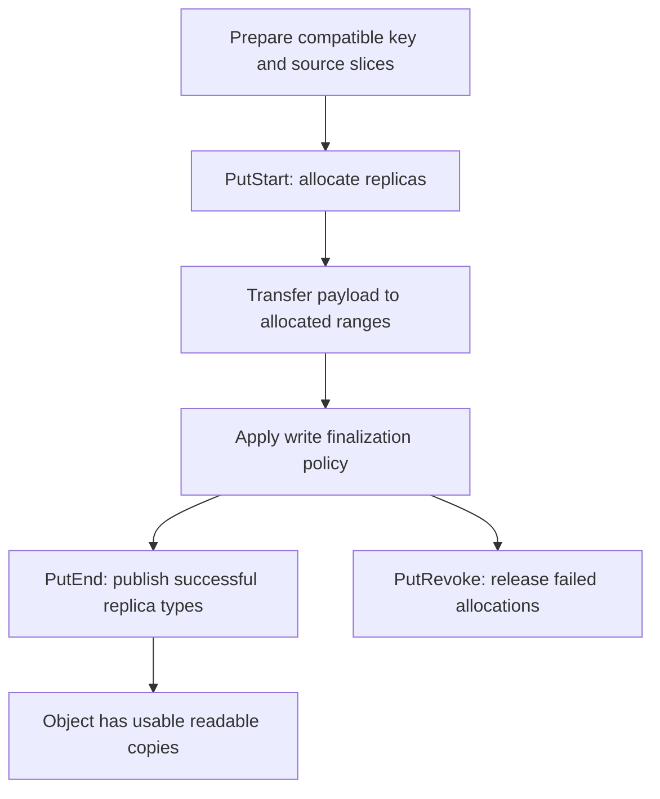

import Source from '../../../../components/Source.astro';

## A write joins allocation, transfer and publication

Store Put coordinates source memory, master-owned replica allocation, data movement
and final metadata. Those phases keep a partially transferred object from becoming
a usable cache hit. The caller chooses a compatible key and representation and
keeps source memory valid through the operation's completion contract.

Use the ordinary immutable-cache write as the baseline. An existing-object success
means the key is already present, rather than that newly supplied bytes overwrote
its contents. Namespace design therefore belongs to cache correctness.

## Follow the normal write

The graph separates byte movement from authority to serve the object. Allocated
replicas initially carry processing state; the master changes availability only
through the appropriate finalization operation.

## Trace the owners through the operation

The client prepares logical slice lengths and applicable integrity information,
then calls PutStart. The master protects the key, allocates replica ranges and
returns descriptors. The client uses those descriptors to move the bytes through
Transfer Engine or the selected storage path.

It records the actual transfer outcomes by medium before deciding what to finalize
or revoke. Publication is scoped to the successful replica type; completing one
memory copy does not automatically complete an unrelated storage allocation.
The metadata retains writer identity so finalization acts on the intended write.

Failure cleanup follows those same owners: the application retains its source
while work uses it, the client resolves transfer outcomes, and Store releases
unpublished reservations through revocation.

## The few choices that change success

**Key semantics:** use stable immutable identities for reusable state. Mutation
requires the separate update contract rather than repeatedly putting different
contents under one key.

**Replica policy:** the reliable path and specialized flexible memory/storage
configuration use different acceptance rules. The flexible mode can publish its
successful side and revoke a failed side. Interpret success through the selected
policy and actual allocations, rather than assuming every requested copy exists.

**Storage medium:** a memory publication supplies a readable copy under that
medium's lifetime. Persistent payloads and metadata durability require their own
configured contracts.

These are sufficient to follow ordinary Put before reading per-medium scheduling
or diagnostic options.

## Read the code

Read `Client::Put` → `PutStart` → transfer/finalization decision → `PutEnd` or `PutRevoke`.

<Source project="mooncake" path="mooncake-store/src/client_service.cpp" label="Client::Put and finalization decisions" />
<Source project="mooncake" path="mooncake-store/include/replica.h" label="Replica write policy" />
<Source project="mooncake" path="mooncake-store/src/master_service.cpp" label="PutStart, PutEnd and PutRevoke authority" />
