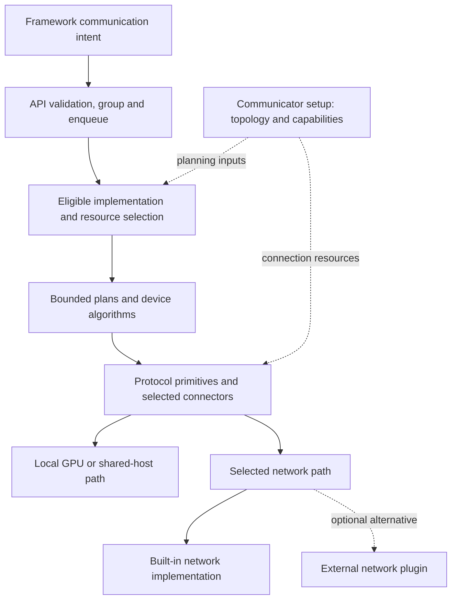

import SystemMap from '../../../components/SystemMap.astro';

## Why it exists

A model split across GPUs often needs values combined before the next layer can run. **All-reduce**, for example, sums corresponding elements from every participant and gives the result to all of them. NCCL implements GPU communication so frameworks can request that result without building their own peer exchanges, network progress, and synchronization machinery.

The framework chooses the mathematical operation and tensor layout. NCCL plans its execution across available GPUs and links, supporting collectives such as all-reduce, reduce-scatter, and all-gather, plus peer send/receive.

## Where it fits

<SystemMap current="nccl" />

An inference engine or tensor framework calls NCCL from distributed model execution. A **communicator** identifies the cooperating group; each member has a **rank** within that group. Request admission, token scheduling, and model placement belong to the engine around it.

NCCL has built-in network implementations and an optional external plugin interface. [AWS OFI NCCL](/architecture/aws-ofi-nccl/) implements that interface using libfabric. That stack is one network choice, rather than a dependency of every NCCL deployment.

## Architecture overview

Trace communication downward through these owners:

Solid arrows follow communication work; dashed arrows supply setup inputs or an optional alternative.

| Layer | Main responsibility |
| --- | --- |
| Framework | Choose semantics, match rank calls, retain tensors and stream dependencies |
| Communicator and topology | Establish participants, usable paths, and communication graph candidates |
| Enqueue, tuning, and planning | Select an eligible implementation and pack bounded work |
| Device algorithm and protocol | Exchange/reduce chunks, publish readiness, and protect reuse |
| Transport and proxy | Supply concrete memory access or network request progress |

Keep **algorithm**, **protocol**, and **transport** distinct. A ring is an exchange algorithm. Simple is a buffering/readiness protocol. P2P or NET supplies the actual edge mechanism. Different combinations can implement the same collective.

## Follow an operation

For an all-reduce, the main path is:

1. Initialize a communicator with matching group membership and rank/device placement.
2. Call `ncclAllReduce` with tensor pointers, element count, datatype, reduction, communicator, and CUDA stream.
3. Enqueue and group processing validate and prepare the work. Tuning selects an implementation using the operation and topology.
4. Planning produces bounded device work. The selected kernel exchanges chunks through local or network connections.
5. Consume the result after its stream dependency is satisfied, then retire storage after all users finish.

The [all-reduce trace](/architecture/nccl/all-reduce-trace/) follows one Ring/Simple example through those handoffs. A successful host enqueue precedes GPU result readiness; the framework must preserve both matching collective order and tensor lifetime.

## Decision gates

| Decision | Owner | Architectural consequence |
| --- | --- | --- |
| Who needs the result? | Framework | Determines all-reduce, reduce-scatter, all-gather, or another operation |
| Where do ranks run? | Framework/operator | Determines local versus inter-node paths and resource access |
| Which implementation fits this operation? | NCCL tuning | Selects eligible algorithm/protocol and GPU resources |
| How is failure handled? | Framework with NCCL status | Coordinates abort/recovery and rejects incomplete results |

Start with semantics and placement, then inspect selected runtime choices. Algorithm overrides are useful experiments after those foundations are correct.

## Explore the code

Read [public contracts](/architecture/nccl/public-api/), [communicator setup](/architecture/nccl/communicators/), and [topology discovery](/architecture/nccl/topology-discovery/) first. Continue through [planning](/architecture/nccl/task-planning/) to [device kernels](/architecture/nccl/device-kernels/), then follow the selected [local transport](/architecture/nccl/local-transports/) or [network/proxy path](/architecture/nccl/network-and-proxy/).

The corresponding source entrypoints are [collectives.cc](https://github.com/NVIDIA/nccl/blob/3e46c089f4ae4732722a419eb6096aead7e47a30/src/collectives.cc), [init.cc](https://github.com/NVIDIA/nccl/blob/3e46c089f4ae4732722a419eb6096aead7e47a30/src/init.cc), [enqueue.cc](https://github.com/NVIDIA/nccl/blob/3e46c089f4ae4732722a419eb6096aead7e47a30/src/enqueue/enqueue.cc), and [transport/net.cc](https://github.com/NVIDIA/nccl/blob/3e46c089f4ae4732722a419eb6096aead7e47a30/src/transport/net.cc). Use [lifecycle and diagnosis](/architecture/nccl/lifecycle-and-diagnosis/) to connect a stalled transition to its owner.
