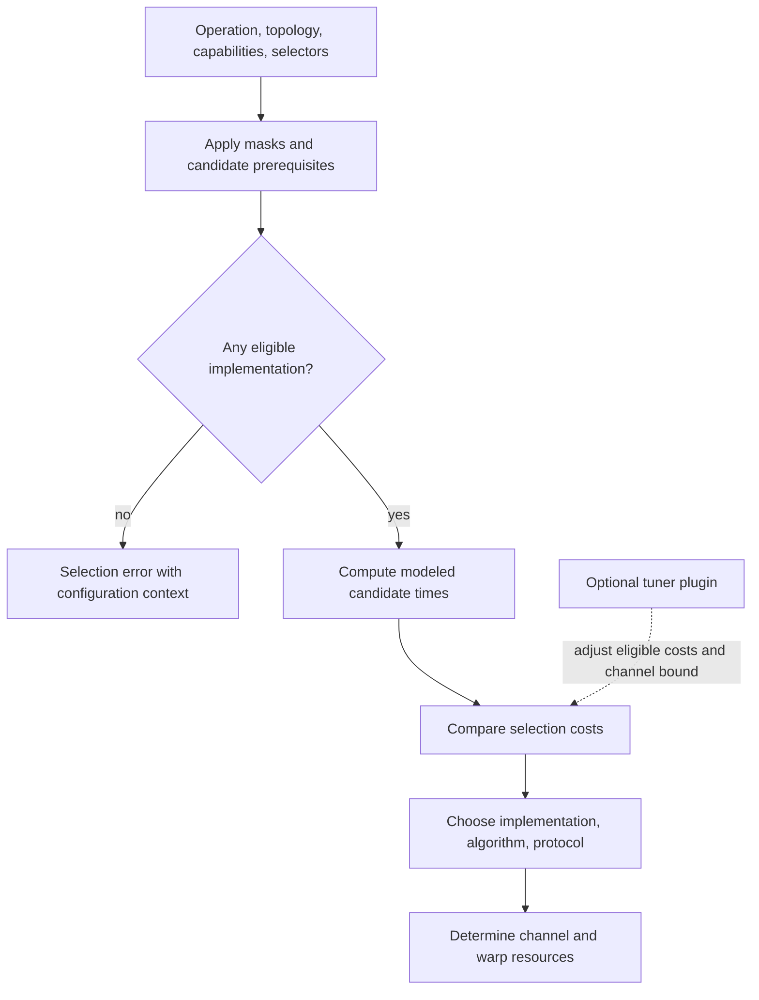

import Source from '../../../../components/Source.astro';

## Choose among feasible implementations

The same all-reduce can use different algorithms and protocols on the same communicator. The operation's size and semantics combine with topology, registration, and backend capabilities to determine what is eligible and which choice is likely to be useful.

Keep three layers separate: an **algorithm** defines peer/chunk exchanges, a **protocol** defines data readiness and buffering, and a **transport** provides the concrete local or network path. Tuning selects implementation and execution resources within those constraints.

## Follow the selection flow

Default task preparation builds `ncclTuningInput_t` and invokes `ncclTuningCompute`. The reorganized preparation path also reaches that common tuning interface.

<Source project="nccl" path="src/enqueue/enqueue.cc" lines="2159-2226" label="Preparation to common tuning" />

Eligibility comes before cost comparison. Optional tuner policy can influence supported choices; an unavailable implementation still needs its underlying capabilities.

The inputs include collective function, datatype, byte count, rank/node arrangement, graph candidates, registration state, and configuration. Candidate filtering excludes implementations that cannot perform the requested operation in that environment.

<Source project="nccl" path="src/tuning/tuning.cc" lines="128-150" label="Candidate filtering and validity" />

## Interpret the cost model

The time model combines fixed latency with a transfer term based on bytes and effective bandwidth. Small messages are often dominated by startup overhead; larger messages place greater weight on bandwidth and parallelism. This explains why a small activation and a large tensor can select different implementations.

The model uses topology/device-derived inputs and implementation corrections. It estimates a choice without benchmarking every candidate on each call. Model values help explain selection; actual workload timing evaluates performance.

<Source project="nccl" path="src/tuning/tuning_general.cc" lines="50-68" label="Latency and bandwidth time model" />

After selection, tuning sets resources such as channels and GPU thread groups, called warps. More parallel work can fill links but also consume GPU resources needed by model computation. Evaluate communication in its execution context rather than maximizing one tuning number.

## Identify who changes the decision

NCCL performs automatic selection. Operators or integrators can constrain choices through supported configuration. An optional tuner plugin can adjust the candidate cost table and resource limits.

<Source project="nccl" path="src/tuning/tuning.cc" lines="180-235" label="Optional tuner callback and final selection" />

For a useful performance comparison, retain operation size/type, rank placement, selected algorithm/protocol, channel count, and active overrides. A change in registration or plugin selection can alter the available menu as well as the estimated cost.

Use forcing to investigate a specific mechanism after confirming it is supported. For routine execution, automatic selection keeps topology and operation differences in the decision. A forced choice cannot supply missing hardware or repair mismatched collective calls.

## Read the code

Start at the default selector's tuning input, then candidate filtering in `tuning.cc`, the selected algorithm model, and channel/thread allocation in `tuning_general.cc`. Follow its result into the planned kernel to connect the modeled decision with actual execution.
