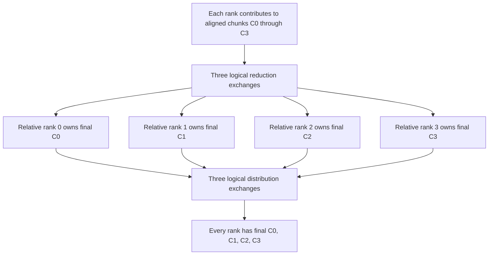

import Source from '../../../../components/Source.astro';

## Fix one path and follow it end to end

Consider four ranks performing a sum all-reduce. Rank 0 contributes ones, rank 1 tens, rank 2 hundreds, and rank 3 thousands. Every output element must be 1111 on every rank.

For this walkthrough, follow a supported general **Ring/Simple** implementation. Ring names the exchange algorithm; Simple names its buffering/readiness protocol. Tuning chooses an implementation at runtime, so establishing the selected path is the first step in a source trace.

## Follow the host handoffs

1. **Describe the operation.** `ncclAllReduce` records the buffers, element count, datatype, reduction, communicator, and stream.
2. **Enqueue matching work.** `ncclEnqueueCheck` validates and appends the task. Outer group processing coordinates the submitted work.
3. **Select and prepare.** Tuning chooses an eligible implementation and resources. Planning packs bounded work records for the selected channels.
4. **Launch and progress.** Device code performs the ring's exchanges; a selected network edge also needs its transport/proxy progress.

<Source project="nccl" path="src/collectives.cc" lines="188-220" label="Public operation to enqueue" />
<Source project="nccl" path="src/enqueue/enqueue.cc" lines="1695-1774" label="Bounded launch plans" />

The [task-planning chapter](/architecture/nccl/task-planning/) identifies the default preparation path in this source revision. Keep this walkthrough centered on the handoffs rather than every alternative task family.

## Follow chunk ownership around the ring

Take one channel and a conceptual supported aligned partition into chunks C0–C3. During reduction, partial chunks circulate and accumulate all four ranks' contributions. During distribution, the completed chunks reach every participant:

For four ranks, the logical schedule has three reduction exchanges and three distribution exchanges. Actual kernel ranges depend on channel partitioning and alignment; the drawing describes ownership through the phases.

The last reduction step also stores and forwards the completed chunk. Later steps copy final values without another reduction. That fused transition connects the two conceptual phases inside the selected kernel.

<Source project="nccl" path="src/device/all_reduce.h" lines="14-83" label="Ring partition, reduction, and final distribution" />

## Follow readiness on each edge

Simple primitives wait for send credit or received readiness, move/reduce data, and publish progress. A local P2P edge uses its established mappings. For a NET edge, a sender proxy posts produced slices, tests requests, and returns credit. A receiver proxy completes the required visibility work before releasing its GPU consumer.

<Source project="nccl" path="src/device/prims_simple.h" lines="98-160" label="Simple readiness and buffer use" />
<Source project="nccl" path="src/transport/net.cc" lines="1640-1729" label="Network receive visibility and progress" />

The algorithm supplies the ring dependency; the protocol and selected transport supply the mechanism that satisfies it. This separation is the useful stopping point for a first architecture trace. Continue into the transport only when diagnosing that edge.

## Retire work and consume the result

The framework consumes the output after the communication stream dependency is satisfied, and retains buffers through all users. A successful host enqueue is earlier than this point. An asynchronous error leaves incomplete output invalid for the next model layer.

For a complete trace, identify the API request, plan, channel work, primitive, selected connector, and result-consumer dependency. That chain connects tensor mathematics to execution without assuming all ranks use one physical transport.
