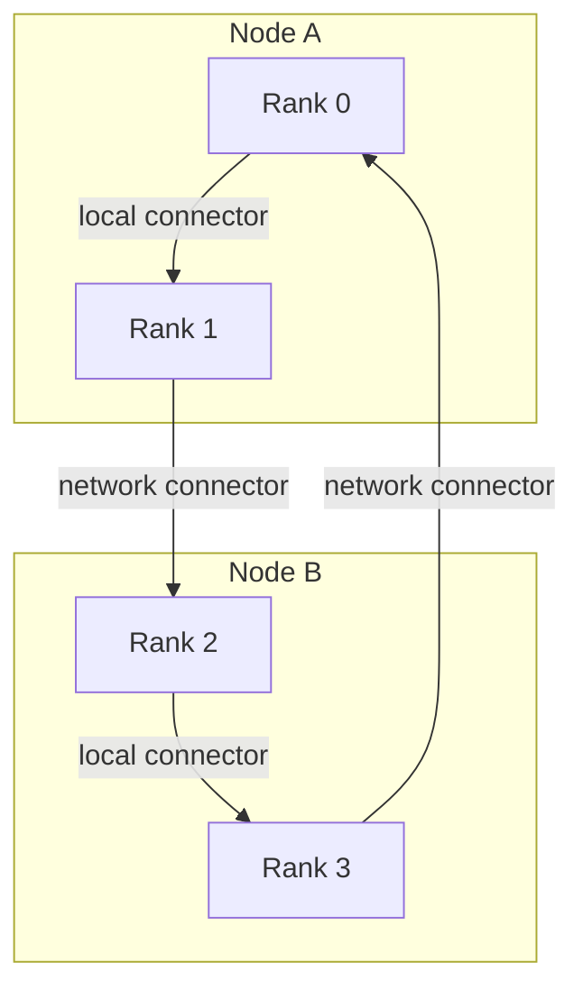
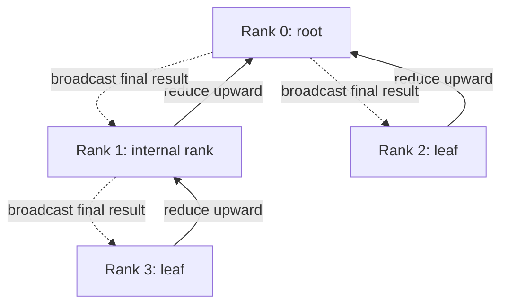

import Source from '../../../../components/Source.astro';

## Embed a communication pattern in the machine

The system graph describes hardware and usable paths. A **communication graph** describes how ranks will communicate over those paths: local rank order, inter-node endpoints, and parallel channels. NCCL prepares several candidates because different operations can benefit from different exchange patterns.

`ncclTopoGraph` holds a requested pattern and channel limits, then receives search results such as channel count, path types, local orders, and intra/inter-node bandwidth estimates.

<Source project="nccl" path="src/include/graph.h" lines="174-194" label="Communication graph inputs and results" />

## Compare ring and tree relationships

A ring gives every rank a predecessor and successor. Here is one teaching arrangement for four ranks on two nodes:

Local and cross-node edges can use different transports. The selected order comes from topology search; this drawing illustrates the relationship.

A tree expresses parent/child relationships. Reduction moves toward the root and the final result moves back down:

Both patterns implement the same all-reduce result, but expose different parallelism and communication depth. Their execution is covered in [device kernels](/architecture/nccl/device-kernels/).

## Search within resource constraints

Initialization requests ring and balanced-tree graphs. Specialized graph families, including NVLink-switch and collective-network paths, are additional candidates when supported. They extend the available implementation menu without becoming requirements for ordinary NCCL communication.

<Source project="nccl" path="src/init.cc" lines="1420-1467" label="Graph families prepared during initialization" />

Search embeds each pattern into usable paths while accounting for shared link capacity, channel bounds, and network placement. It operates within a search budget. The result is a feasible planning candidate, rather than a benchmark of the current tensor or a proof of a globally optimal placement.

<Source project="nccl" path="src/graph/search.cc" lines="1151-1318" label="Graph search and resource bounds" />

## Treat channels as parallel work lanes

A channel carries peer relationships and work state. More channels can expose more concurrent chunks and help fill links for large transfers. They also use connections, work storage, and GPU resources. Channel count therefore belongs to planning and tuning, not to hardware inventory.

Initialization establishes feasible structures; per-operation selection chooses the implementation and resources for the current message. Small and large all-reduces on the same communicator can reasonably select different choices.

Graph results become concrete ring/tree channel relationships and transport connections before execution. This is the boundary to inspect when a useful-looking graph fails to become usable communication.

<Source project="nccl" path="src/graph/connect.cc" label="Graph results converted into channel relationships" />

## Read the code

Read `ncclTopoGraph`, initialization's graph requests, `ncclTopoCompute`, then `connect.cc`. Preserve the distinction among detected topology, graph candidates, and the operation's selected implementation when reading logs. Continue to [algorithm selection](/architecture/nccl/algorithm-selection/) for the final choice.
