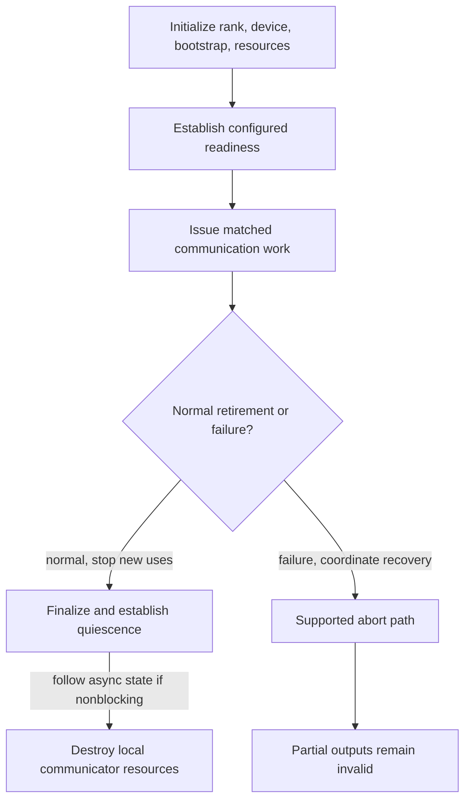

import Source from '../../../../components/Source.astro';

## A communicator prepares a group for repeated work

A communicator is NCCL's long-lived relationship among participating GPUs. It holds rank identity, topology, connections, planning state, and internal communication resources. Creating it once lets many model operations reuse that setup.

The application chooses group membership and the rank-to-device mapping. NCCL constructs the communication machinery. Model tensors remain owned by the framework throughout this relationship.

## Establish identity and exchange peer information

The application obtains a unique ID, distributes it to the intended participants, and sets each participant's current CUDA device before calling `ncclCommInitRank`. Each rank is unique within the group. A process controlling several GPUs must arrange supported grouped or concurrent initialization so peers can participate together.

<Source project="nccl" path="src/nccl.h.in" lines="275-303" label="Unique ID, rank, and device setup" />

Initialization uses **bootstrap** communication to exchange peer identity and hardware information. Bootstrap is the setup channel; later collective payloads use the connections selected for GPU communication. Keeping the two stages separate helps locate a failure before or after data-path setup.

<Source project="nccl" path="src/init.cc" lines="1230-1256" label="Local peer information and bootstrap all-gather" />
<Source project="nccl" path="src/bootstrap.cc" label="Bootstrap communication" />

## Build the execution resources

Using the exchanged information, initialization discovers local topology, computes usable paths, searches communication graphs, and prepares internal resources. A **channel** is a parallel lane of NCCL work and peer state; multiple channels can share the same physical link.

The communicator ties these results together: topology supplies feasible routes, graph candidates supply peer relationships, and connection state supplies usable addresses and transports. Resources can be connected when the selected execution path needs them, so successful initialization is preparation for communication rather than a record of every future transfer.

<Source project="nccl" path="src/init.cc" lines="1380-1467" label="Topology and communication graph setup" />
<Source project="nccl" path="src/include/comm.h" label="Communicator ownership and shared resources" />

Configured nonblocking initialization exposes readiness through asynchronous state. A framework must finish that readiness protocol before submitting communication; NCCL also checks readiness at enqueue.

## Retire the group deliberately

For normal shutdown, stop new submissions, finalize issued work, wait for global quiescence—when issued communication has settled across the group—and destroy the remaining local resources. Failure recovery uses abort or another supported management path and invalidates incomplete results.

This conceptual lifecycle separates successful shutdown from failure recovery. Tensor retirement still follows its GPU and communication users.

`ncclCommFinalize` drives issued communication toward quiescence. `ncclCommDestroy` frees remaining local resources. `ncclCommAbort` aborts operations that may still be running. A peer restart requires application-level membership recovery; it does not update the old communicator automatically.

<Source project="nccl" path="src/nccl.h.in" lines="304-332" label="Finalize, destroy, and failure-oriented management" />

## Read the code

Start at `ncclCommInitRank` in `init.cc`, follow peer bootstrap, then topology and connection setup. Return to the finalize/destroy/abort entrypoints to see how the same ownership is retired. Continue with [topology discovery](/architecture/nccl/topology-discovery/) for the first planning input.
