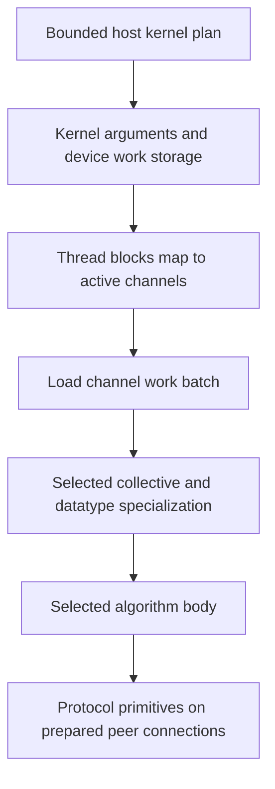

import Source from '../../../../components/Source.astro';

## Execute the plan on the GPU

Host planning selects an implementation and produces compact device work records. A general NCCL kernel consumes those records, assigns work to channels, and runs the selected collective algorithm with its protocol primitives.

This chapter follows the general-kernel family. Specialized implementations have their own execution paths, but the main separation remains useful: host code plans communication, device code performs chunk movement and reduction, and transport resources supply the connections.

## Follow work into the selected algorithm

A kernel can consume multiple compatible records, and one collective can use several channels. API calls, kernel launches, channels, and chunks are therefore different units of work.

The common entrypoint loads kernel arguments and work batches, maps blocks to active channels, and dispatches the implementation selected by collective, datatype, reduction, algorithm, and protocol. **Channels** are logical lanes of communication work; they are mapped onto GPU execution resources by the launch.

<Source project="nccl" path="src/device/common.h" lines="420-510" label="Kernel entry, channels, batches, and dispatch" />
<Source project="nccl" path="src/device/generate.py" label="Generated collective implementation combinations" />

## Read ring and tree as dataflow

A ring all-reduce has two logical phases. First, chunks circulate while accumulating contributions, leaving a complete reduced chunk at each owner. Then completed chunks circulate so every rank obtains the full result.

The final reduction can receive, reduce, store, and forward in one primitive. Later steps forward completed data without reducing it again. These fused actions make the device path more efficient than a sequence of separate kernels for each conceptual arrow.

<Source project="nccl" path="src/device/all_reduce.h" lines="14-83" label="Ring reduction and distribution" />

A tree instead combines child contributions toward a root, then distributes the result downward. Parent, child, and root roles determine the work. Both patterns implement the same requested result while exposing different communication depth and concurrency.

<Source project="nccl" path="src/device/all_reduce.h" lines="86-173" label="Tree reduction and distribution roles" />

## Separate algorithm from readiness

An algorithm determines which peers exchange which chunks. **Primitives** implement actions such as send, receive, and receive-reduce-send. Their selected protocol governs buffers, progress counters, flags, and safe reuse.

The transport provides usable peer addresses or network-backed buffers beneath those primitives. A device wait can therefore depend on another GPU, host proxy progress, or the selected network implementation. A kernel method name alone is insufficient to identify the physical path.

<Source project="nccl" path="src/device/primitives.h" label="Protocol-specialized primitive interface" />

Application buffers and device-visible work storage must remain valid for those readers. Abort handling can stop progress waits during failure, but incomplete output must be treated as failed work by the framework.

## Read the code

Follow the common entrypoint into the selected `runRing` or tree implementation, then the primitive for the selected protocol. Use [the all-reduce trace](/architecture/nccl/all-reduce-trace/) for a concrete chunk walkthrough and [device protocols](/architecture/nccl/device-protocols/) for the readiness mechanism underneath it.
