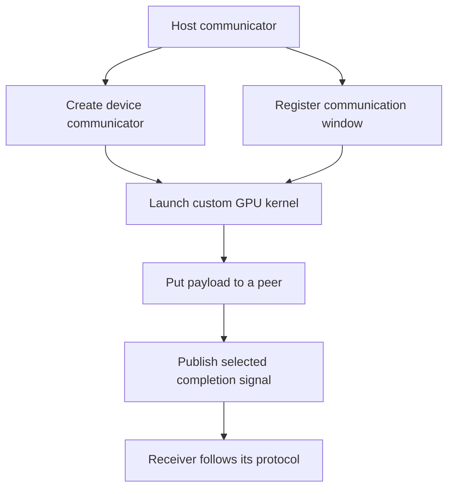

import Source from '../../../../components/Source.astro';

## Let custom GPU kernels express communication

The ordinary collective API lets NCCL plan a complete operation. The device API instead gives a custom GPU kernel communication primitives and addressing resources. A specialized runtime can combine communication with its own dispatch, reduction, or computation schedule.

That flexibility transfers protocol responsibility to the custom algorithm author. It must define peer roles, readiness signals, execution dependencies, and safe buffer reuse. Device networking is an additional execution path, rather than a replacement for every host-enqueued collective.

<Source project="nccl" path="src/include/nccl_device/README.md" label="Device API organization" />

## Prepare the resources, then launch the kernel

The two resource inputs are prerequisites, not a required ordering between window registration and device communicator creation. Retain both resources and their backing allocations through their last user.

Creation checks the communicator's readiness, selected backend, and requested capabilities. Describe the resources and signal behavior the kernel needs before launch; support depends on the device/backend configuration.

<Source project="nccl" path="src/dev_runtime.cc" lines="1979-2038" label="Device communicator requirements and creation" />

## Use windows for remote memory identity

A registered **window** gives memory a supported communication identity. Peer/team coordinates and offsets identify the target range. This supplies the interpretation that a raw pointer alone cannot carry between GPUs or processes.

The application owns the actual allocation. Registration allows communication access; deregistration and freeing storage require the custom work to have finished using it. Ordinary collective buffer registration and device windows are separate API contracts.

<Source project="nccl" path="src/nccl.h.in" lines="450-463" label="Window registration and deregistration" />
<Source project="nccl" path="src/include/nccl_device/host.h" lines="146-169" label="Device communicator and window pointer APIs" />

## Choose the signal that matches the dependency

**Gin**, NCCL's GPU-initiated networking interface, defines signal semantics for the receiver. A supported **strong signal** covers preceding puts within its documented scope. A **weak signal** covers only its bundled put.

For example, putting A, then putting B with a weak signal does not make that signal an acknowledgement for A. A custom algorithm must choose a supported completion action that covers everything its consumer needs, and request the corresponding capabilities when creating resources.

<Source project="nccl" path="src/include/nccl_device/gin.h" lines="22-42" label="Strong and weak signal contracts" />
<Source project="nccl" path="src/include/nccl_device/host.h" lines="48-76" label="Requested signal capabilities" />

This is the central decision: are you using NCCL's complete collective schedule, or authoring a GPU communication protocol whose dependencies you own? The device API helps implement the latter but does not infer those dependencies from a model's intent.

## Read the code

Start with public device declarations, then `dev_runtime.cc` resource creation and the selected Gin implementation. The custom all-reduce contribution shows one consumer's setup and cleanup. Read its protocol as an example for those resources, not as the default implementation of `ncclAllReduce`.

<Source project="nccl" path="contrib/custom_algos/allreduce/main.cu" lines="286-327" label="Custom consumer resource setup" />
