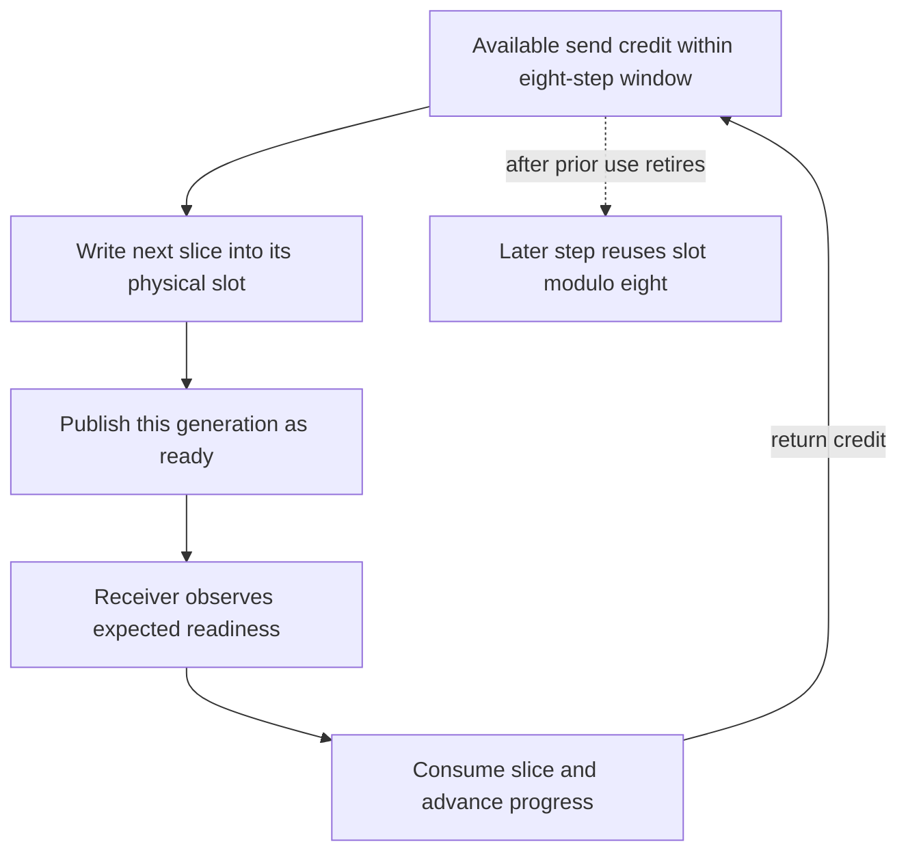

import Source from '../../../../components/Source.astro';

## Make data readiness and storage reuse explicit

An algorithm defines the exchange pattern. A protocol defines how peers represent data, publish readiness, and reuse finite communication buffers. A transport supplies the local or network path. A ring can therefore use different protocols without changing the requested all-reduce mathematics.

NCCL's general protocols are Simple, LL, and LL128. Their different readiness mechanisms trade fixed overhead, payload efficiency, and implementation constraints. Tuning selects an eligible protocol for the operation and environment.

## Follow one buffer through the credit cycle

Communication buffers have finite capacity. A producer needs available space before writing; a consumer needs readiness before reading. After consumption, progress returns capacity to the producer:

The inspected connection uses an eight-step window. Logical steps keep advancing while physical slots are reused modulo that window. Readiness identifies the current use of a slot, and credit protects it from being overwritten too soon.

<Source project="nccl" path="src/include/device.h" lines="26-28" label="Protocol step window" />
<Source project="nccl" path="src/include/device.h" lines="135-169" label="Connection buffers and progress pointers" />

For example, a producer that fills the window must wait until the consumer advances before reusing the first slot. Reusing the same address is safe only after that ownership transition. The same principle applies whether data crosses a local GPU link or passes through network progress machinery.

## Compare the protocol representations

| Protocol | Readiness mechanism | Architectural implication |
| --- | --- | --- |
| Simple | Progress counters around slices of data | Payload movement and progress publication are separate actions |
| LL | Flags stored alongside small data units | Fine-grained readiness reduces separate observation but adds flag overhead |
| LL128 | Larger flag-bearing lines | More payload shares each readiness flag, with its own supported access/ordering assumptions |

Simple primitives wait for received progress or available send credit, access the selected buffer, and publish the next progress point with the required ordering.

<Source project="nccl" path="src/device/prims_simple.h" lines="98-160" label="Simple wait and publication" />

LL receivers check paired flags before using a line's data. LL128 uses a larger line representation and coordinated flag-bearing loads/stores. Both depend on the transport satisfying the representation's ordering and atomicity assumptions; choosing a lower-overhead format cannot replace those prerequisites.

<Source project="nccl" path="src/include/device.h" lines="77-122" label="LL and LL128 data/flag layouts" />
<Source project="nccl" path="src/device/prims_ll.h" lines="105-124" label="LL readiness check" />
<Source project="nccl" path="src/device/prims_ll128.h" lines="180-205" label="LL128 receive readiness" />

## Read a stall at the right layer

A waiting primitive is missing a particular transition: peer production, receive readiness, or returned credit. The cause can be an unmatched collective, delayed proxy/network progress, or a peer failure. Check which transition is missing before changing the protocol.

The framework still owns tensor lifetime and matching operations. Internal credits protect communication slots; they do not order every unrelated application write to a tensor.

## Read the code

Start with connection state in `device.h`, then the selected `prims_simple.h`, `prims_ll.h`, or `prims_ll128.h`. Trace wait → data action → publication. Continue to [network and proxy](/architecture/nccl/network-and-proxy/) to see how host progress participates in those transitions.
