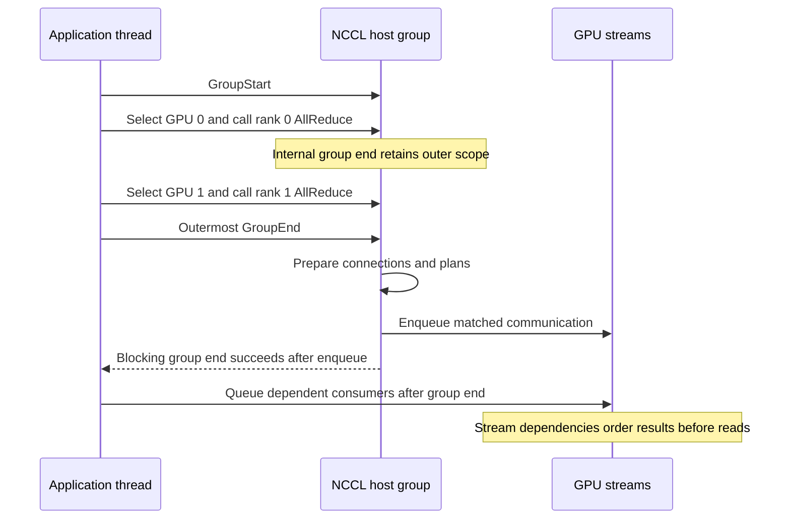

import Source from '../../../../components/Source.astro';

## Collect related calls before launching work

A framework often issues several communications together, possibly for multiple local GPUs. NCCL groups let one host scope accumulate those calls and coordinate their preparation and launch. This is especially useful when one thread controls several ranks that must participate in the same operation.

Every public collective enters an internal group scope through `ncclEnqueueCheck`. An explicit application group encloses those internal scopes. Actual group processing happens at the outermost end.

<Source project="nccl" path="src/enqueue/enqueue.cc" lines="3478-3536" label="Internal group, validation, and task append" />

## Follow a two-GPU group

One thread opens a group, sets GPU 0 and issues rank 0's all-reduce, then sets GPU 1 and issues rank 1's matching call. The outer group end prepares and enqueues their work:

The completed blocking group-end case establishes enqueueing. Result consumption still follows CUDA stream ordering or explicit synchronization.

Group nesting and accumulated errors live in thread-local state. An inner group end returns control to its enclosing scope; the outer end coordinates the collected work. The framework must also keep collective ordering compatible across remote ranks.

<Source project="nccl" path="src/group.cc" lines="1040-1065" label="Outermost group processing" />

## Trace preparation into launch

Enqueue validates readiness and local arguments, then appends an operation description. Group processing prepares tasks, connects required resources, and coordinates kernel launches. A public call, group, and kernel are different units: one group can produce several plans, and a plan can contain multiple compatible operations.

The [task-planning chapter](/architecture/nccl/task-planning/) identifies the active source path for this revision. For a first trace, follow `taskAppend`, group processing, and `doLaunches`; the preparation stages determine what reaches launch.

Grouping coordinates work submission. Tensor dependencies remain the framework's responsibility. Calls in separate groups can still share an allocation, and calls inside one group can use entirely different tensors.

## Place dependent work after the boundary

For grouped communication, queue dependent CUDA work after group end so it follows communication that has actually been enqueued. A producer, collective, and consumer can then use same-stream ordering. Cross-stream consumers need an explicit dependency.

<Source project="nccl" path="src/nccl.h.in" lines="849-884" label="Group-end guarantee and dependent work" />

Configured nonblocking groups additionally expose asynchronous host progress. Follow their readiness/error protocol before assuming preparation is complete. In either mode, retain application buffers until their GPU and transport users are safe.

Inspect the collective calls and group-end result for direct errors, then communicator asynchronous state for failures after enqueue. A group is a submission mechanism, not an atomic transaction that rolls back distributed effects.

## Read the code

Start with the public group contract, then `ncclEnqueueCheck`, `taskAppend`, and `ncclGroupEndInternal`. Follow the selected preparation path into launch. This route answers where intent is recorded, where peers are coordinated, and where execution begins without requiring every internal task subtype first.

<Source project="nccl" path="src/group.cc" lines="985-1034" label="Preparation and coordinated launch paths" />
