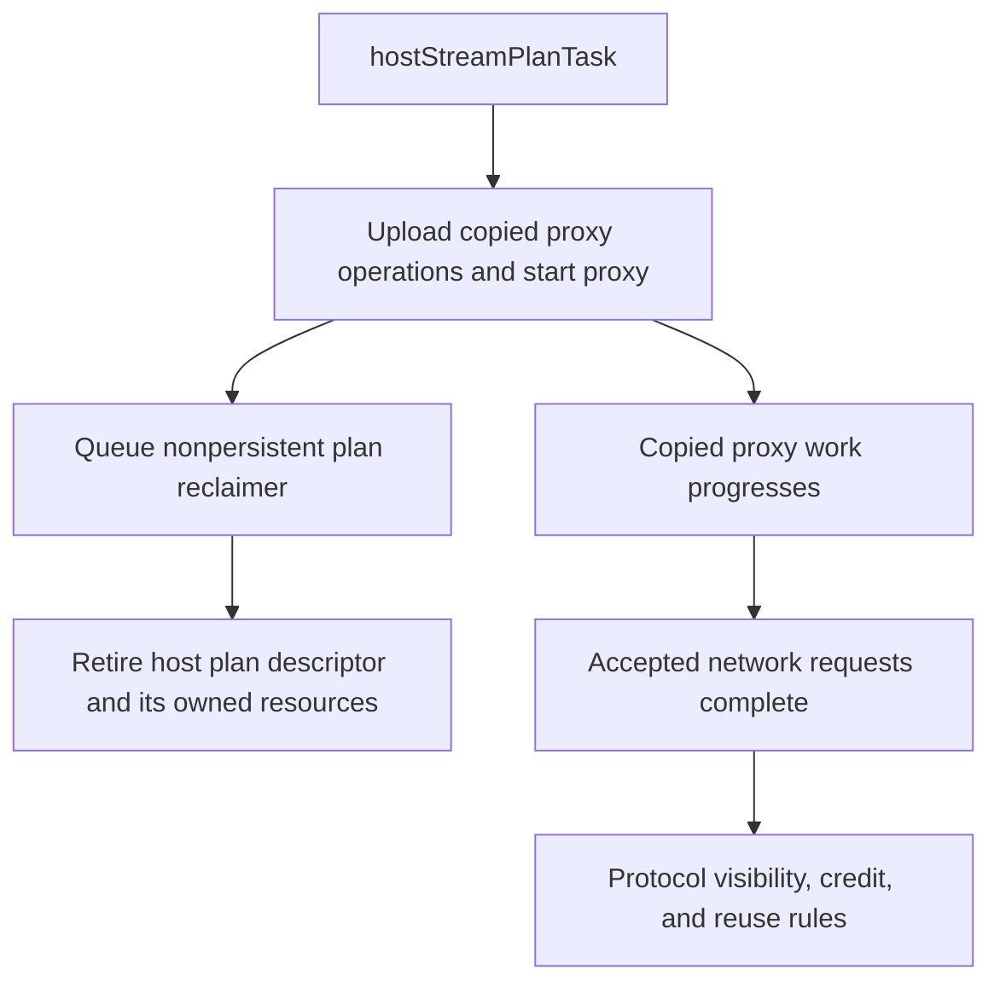

import Source from '../../../../components/Source.astro';

## Track the owner of each lifetime

An asynchronous collective involves more than the application tensor. Registrations describe transport access, plans describe queued work, requests track network progress, and the communicator holds shared state. Each has its own retirement condition.

| Resource | Owner | When it can retire |
| --- | --- | --- |
| Tensor allocation | Framework/allocator | All GPU, communication, and application users finish |
| Registration or window | NCCL registration/resource layer | Its users finish and references are released |
| Host plan and device work | Planner and execution machinery | Their separate handoff/reclamation rules permit it |
| Network request | Selected transport/plugin | Completion or supported failure cleanup |
| Communicator | Application and NCCL | Normal quiescence or supported failure management |

This ownership map is the basis for both normal cleanup and diagnosing corruption.

## Registration follows the allocation's use

Registration describes access to an allocation; it does not own the framework's tensor. NCCL can reuse a covering registration-cache entry, with references from ordinary or graph-related users. Deregistration releases those references and applicable resources.

<Source project="nccl" path="src/register/register.cc" lines="26-86" label="Registration ranges, cache entries, and references" />
<Source project="nccl" path="src/register/register.cc" lines="172-206" label="Reference release and resource cleanup" />

Finish communication uses before deregistering or returning memory to an allocator. For example, recycling tensor T immediately after enqueue can let a queued reader consume an unrelated tensor U at the same address. The pointer and registration may still look valid while the model data is wrong.

## Separate host handoff from execution lifetime

A host plan descriptor can be reclaimed after its state has been transferred to execution machinery. Copied proxy work and device-visible storage can continue independently. CUDA graph capture adds persistent resources needed by later replay.

The branches show distinct owners, not a shared destruction moment. In particular, retaining a host descriptor until every network request completes is not the implemented general rule, and freeing a tensor at host return is unsafe.

<Source project="nccl" path="src/enqueue/enqueue.cc" lines="1560-1610" label="Plan callbacks, reclamation, and persistent references" />

For normal communicator shutdown, stop new work, reach quiescence, and release resources. Coordinate failure recovery across the application instead of assuming local cleanup repaired missing peer participation.

## Diagnose the earliest missing transition

Ask three questions in order:

1. **Did ranks issue compatible operations?** Compare collective order, counts, datatypes, and membership.
2. **Did execution and storage stay valid?** Check producer/consumer stream dependencies and allocation lifetime.
3. **Which progress boundary is stuck or failed?** Separate GPU readiness, host proxy request state, and selected backend/peer state.

Inspect both direct API returns and the asynchronous status written by `ncclCommGetAsyncError`. A successful getter call is distinct from the status it reports. Likewise, a healthy communicator status does not substitute for the CUDA dependency protecting an output tensor.

<Source project="nccl" path="src/init.cc" lines="3934-3970" label="Communicator and proxy asynchronous error observation" />

NCCL's diagnostics and RAS health reporting can help locate a failing participant or path. Use them alongside the operation's ownership and progress evidence. They do not establish successful tensor computation on their own.

## Read the code

Follow the resource that matters: registration acquire/release, plan handoff/reclamation, network request progress, or communicator management. The README points to the separate `nccl-tests` project for runtime correctness and performance validation.

<Source project="nccl" path="README.md" label="Runtime validation tools" />
